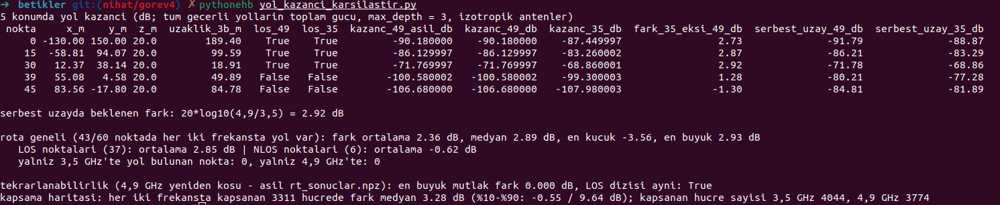
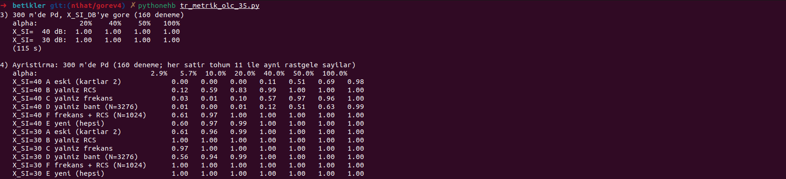
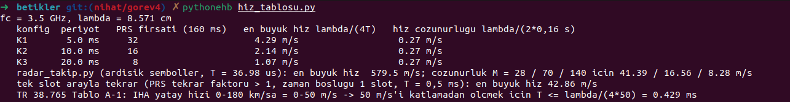
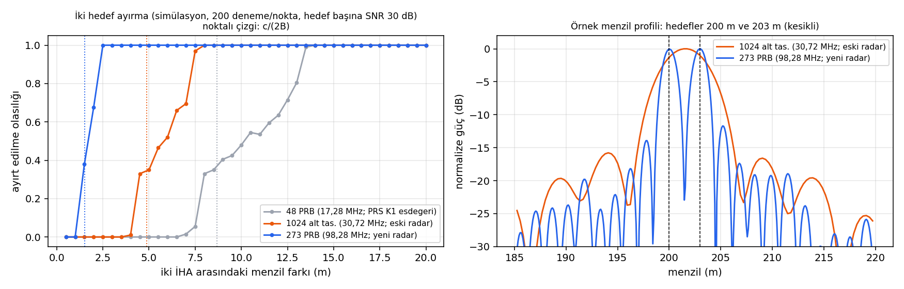
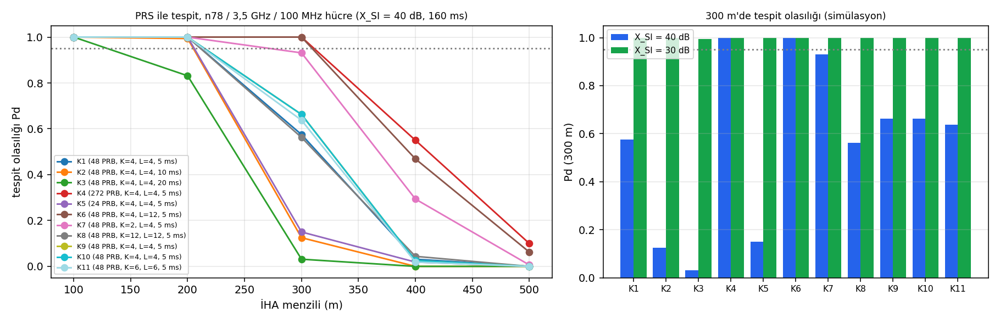
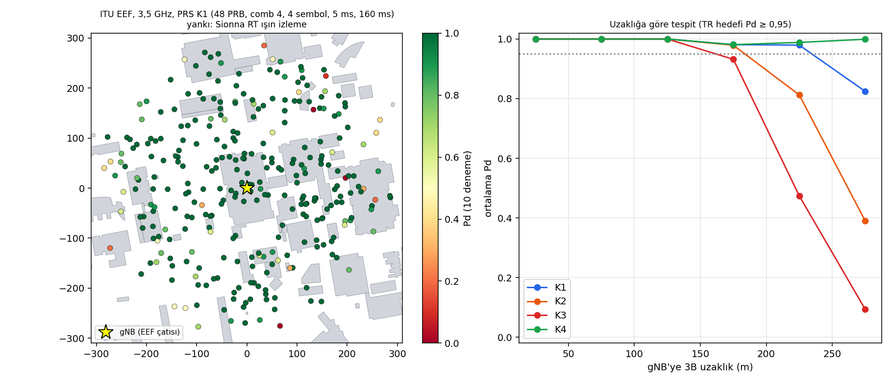
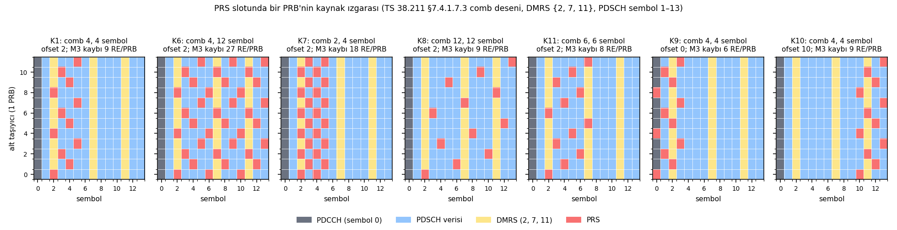
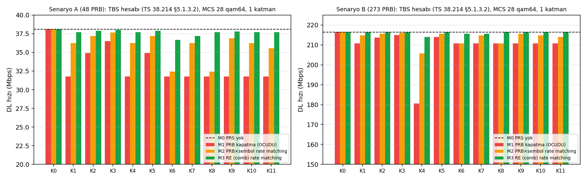

# Nihat – Görev Kartı 4 Uygulama ve Sonuç Raporu

**Konu:** Sionna'da ortak ızgaraya geçiş (n78, 3,5 GHz, 30 kHz, 100 MHz / 273 PRB), radar ve PRS yapılandırması

**Tarih:** 21 Kasım 2026

**Görev kaynakları:** `gorev_kartlari_4/gorev_kartlari_4.pdf` ("Nihat: Sionna'da 3,5 GHz ve PRS sinyali", adım 1–3) ve `gorev_kartlari_4/CLAUDE.md` ("Nihat – Sionna PRS Configuration", "Nihat – Radar Configuration").

> **Özet.** Münih sahnesi Sionna RT ile 3,5 GHz'te yeniden çözülmüştür. Görüş hattı (LOS) bulunan konumlarda yol kazancı 4,9 GHz'e göre serbest uzay beklentisi kadar (+2,9 dB) artmış, LOS bulunmayan konumlarda fark −1,3 … +8,6 dB arasında kalmıştır.
>
> Radar ortak ızgaraya (N = 3276 alt taşıyıcı, 98,28 MHz) ve standart RCS değerine (−12,81 dBsm) taşınmıştır. 300 m'de, X_SI = 40 dB iken Pd, α = %20 / 40 / 50 / 100 için 0,18 / 0,56 / 0,73 / 0,96 değerinden 1,00 değerine yükselmiştir; farkın yaklaşık 7,2 dB'i RCS'ten, 2,9 dB'i frekanstan kaynaklanmaktadır. Bant genişliği Pd'yi değiştirmemiş, menzil çözünürlüğünü 4,88 m'den 1,53 m'ye iyileştirmiştir.
>
> K1–K3 için en büyük hız 4,29 / 2,14 / 1,07 m/s, hız çözünürlüğü 0,27 m/s bulunmuştur (kartın kontrol değerleriyle aynı). PRS, n78 ızgarasında K1–K11 ayarlarıyla, periyot dahil simüle edilmiştir; 300 m'de en yüksek Pd K4 (272 PRB) ve K6 (12 sembol) ile elde edilmiştir (1,00). PRS'in boş bıraktığı kaynakların veriye açılması TS 38.214 §5.1.3.2 TBS hesabıyla değerlendirilmiş; K1'de (48 PRB veri alanı) DL hızı 31,75'ten 37,69 Mbps'e, K4'te (273 PRB) 180,51'den 213,97 Mbps'e çıkmıştır.
>
> Bütün sayılar simülasyon ya da hesap sonucudur; gerçek sahada ölçülmüş değerler değildir.

## 0. Ortam ve genel ilkeler

Çalışma Ubuntu 24.04 üzerinde, `~/venvs/ehb415` ortamında (Sionna 1.2.2, Mitsuba 3.8.0, NumPy 2.2.6) ve depo sürümü `4c31d93` ile yapılmıştır. Sayısal değerler `ogretici/veri/ortak_degerler.xlsx` ve `ogretici/veri/ortak_prs_konfig.csv` (K0–K11) dosyalarından alınmıştır. Kartın gereği olarak asıl betiklere dokunulmamış; `rt_sehir.py`, `radar_takip.py` ve `tr_metrik_olc.py` için `betikler/` altında `_35` ekli kopyalar oluşturulmuştur.

160 denemelik Pd tahmininin standart hatası Pd ≈ 0,5 civarında 0,04, Pd ≈ 0,95 civarında 0,017'dir. Betikler sabit tohumlarla çalışmaktadır; yalnızca `itu_35ghz.py` iki koşu arasında 0,01 düzeyinde farklılık göstermiştir. Komutlar, çıktı dosyaları ve ekran görüntüleri `README.md` ve `EKRAN_GORUNTULERI.md` dosyalarında listelenmiştir; ara hesaplar ve ek tablolar `Nihat_Gorev_Karti_4_Rapor_ayrintili.md` dosyasındadır.

# BÖLÜM A — Radar yapılandırması

## A.1 Adım 1: 3,5 GHz'te yol kazancı (Teslim 1)

`rt_sehir_35.py` kopyasında yalnızca `FC = 4.9e9` satırı `3.5e9` yapılmıştır ("Sionna" B2); Münih sahnesi, gNB (8,5; 21; 27) m, izotropik antenler ve `max_depth = 3` korunmuştur. Aynı betik 4,9 GHz ile de koşulmuş ve asıl `rt_sonuclar.npz` ile birebir aynı sonuç alınmıştır (en büyük fark 0,000 dB). Yol kazancı, alıcıya ulaşan bütün yolların güç toplamı olarak tanımlanmıştır: G = 10·log10(Σ|a_i|²). Beş konum, iki frekansta da yol bulunan rota noktaları arasından LOS (0, 15, 30) ve NLOS (39, 45) durumlarını temsil edecek biçimde seçilmiştir.

### Tablo A.1-a — Münih sahnesi, 5 konumda yol kazancı

| Nokta | Konum (x, y, z) [m] | 3B uzaklık [m] | LOS | 4,9 GHz [dB] | 3,5 GHz [dB] | Fark [dB] |
|---|---|---|---|---|---|---|
| 0 | (−130,0; 150,0; 20) | 189,4 | var | −90,18 | −87,45 | **+2,73** |
| 15 | (−58,8; 94,1; 20) | 99,6 | var | −86,13 | −83,26 | **+2,87** |
| 30 | (12,4; 38,1; 20) | 18,9 | var | −71,77 | −68,86 | **+2,92** |
| 39 | (55,1; 4,6; 20) | 49,9 | yok | −100,58 | −99,30 | **+1,28** |
| 45 | (83,6; −17,8; 20) | 84,8 | yok | −106,68 | −107,98 | **−1,30** |

Kartın 1. adımında "kampüs" ifadesi geçtiğinden aynı karşılaştırma ITU EEF kampüsü için ayrı bir betikle (`itu_35ghz.py`, 200 aday konum) tekrarlanmıştır.

### Tablo A.1-b — ITU EEF kampüsü, 5 konumda yol kazancı

| Aday | Konum (x, y, z) [m] | 3B uzaklık [m] | LOS | 4,9 GHz [dB] | 3,5 GHz [dB] | Fark [dB] |
|---|---|---|---|---|---|---|
| 4 | (63,8; −41,9; 58,5) | 81,5 | var | −84,47 | −81,55 | **+2,92** |
| 11 | (44,8; −132,3; 55,1) | 141,9 | var | −89,29 | −86,37 | **+2,92** |
| 0 | (168,7; 63,5; 213,4) | 257,1 | var | −94,18 | −91,28 | **+2,90** |
| 27 | (−143,0; −124,7; 20,6) | 190,0 | yok | −122,62 | −116,03 | **+6,59** |
| 28 | (−123,6; −53,9; 9,6) | 136,4 | yok | −116,64 | −108,04 | **+8,59** |

*Şekil 1. `yol_kazanci_karsilastir.py` terminal çıktısı: Münih sahnesinde 5 konumluk yol kazancı tablosu, rota geneli istatistikler ve tekrarlanabilirlik denetimi.*

Serbest uzayda beklenen artış 20·log10(4,9/3,5) = **2,92 dB**'dir. LOS konumlarında Sionna RT sonucu bu değerle 0,2 dB içinde uyuşmaktadır (rota geneli LOS ortalaması +2,85 dB, kampüs LOS ortalaması +2,91 dB). NLOS konumlarında yansıma, kırınım ve duvar kayıpları frekansa bağlı olduğundan fark sabit değildir (Münih −1,3 … +1,3 dB, kampüs +6,6 … +8,6 dB). `rt_sehir_35.py` ve `itu_35ghz.py` terminal görüntüleri (`ekran_goruntuleri/rt35.png`, `rt3549.png`, `itu35ghz.png`) aynı değerleri içerdiğinden rapora eklenmemiştir.

## A.2 Adım 2: Radar parametreleri ve Pd (Teslim 2)

`radar_takip.py`, `betikler/radar_takip_35.py` olarak kopyalanmış ve değerler kartın istediği gibi ortak dosyadan alınmıştır.

| Parametre | Eski (`radar_takip.py`) | Yeni (`radar_takip_35.py`) | Kaynak |
|---|---|---|---|
| f_c / λ | 4,9 GHz / 6,12 cm | **3,5 GHz / 8,57 cm** | "Sionna" B2 |
| Alt taşıyıcı sayısı N, SCS | 1024, 30 kHz | **273 × 12 = 3276**, 30 kHz | "Sionna" B3–B4; TS 38.101-1 Tablo 5.3.2-1 |
| Dolu bant W = N·SCS | 30,72 MHz | **98,28 MHz** | türetme |
| Menzil kutusu c/(2W) | 4,88 m | **1,53 m** | türetme |
| Hedef RCS | −20 dBsm (varsayım) | **−12,81 dBsm** | TR 38.901 Tablo 7.9.2.1-1 |
| Verici gücü, NF, anten kazancı | 37 dBm, 5 dB, 26 dBi | aynı | TR 38.765 Tablo A-1; kazanç VARSAYIM |
| X_SI, P_FA | 40 dB (ayrıca 30 dB), 10⁻³ | aynı | TR 38.765 Ek A (X şirkete bırakılmış) |

**RCS notu (kartın istediği cümle):** RCS sabit −12,81 dBsm alındı (TR 38.901 Tablo 7.9.2.1-1, küçük drone ortalaması); standarttaki 3,74 dB sapma modellenmedi, bu yüzden sonuçlar iyimser olabilir.

### Tablo A.2-a — 300 m'de Pd, eski / yeni (kartın istediği tablo; 160 deneme)

| Ayar | X_SI | α = %20 | α = %40 | α = %50 | α = %100 |
|---|---|---|---|---|---|
| Eski: 4,9 GHz, N = 1024, RCS −20 dBsm (kartlar 2) | 40 dB | 0,18 | 0,56 | 0,73 | 0,96 |
| **Yeni: 3,5 GHz, N = 3276, RCS −12,81 dBsm** | 40 dB | **1,00** | **1,00** | **1,00** | **1,00** |
| Eski / yeni | 30 dB | 1,00 / 1,00 | 1,00 / 1,00 | 1,00 / 1,00 | 1,00 / 1,00 |

### Tablo A.2-b — Ayrıştırma: farkın RCS'ten mi, frekanstan mı geldiği (300 m, X_SI = 40 dB)

Kartın istediği tek başına RCS koşusuna ek olarak frekans ve bant da tek tek değiştirilmiştir. Yeni ayarda tablo α = %20–100 aralığında doyduğundan daha küçük α değerleri de taranmıştır. Bütün satırlar aynı rastgele sayılarla (tohum 11) koşulmuştur; A satırının kartlar 2 değerlerinden farkı 0,07'yi aşmamaktadır.

| Ayar | f_c | N | RCS | α = 2,9 % | 5,7 % | 10 % | 20 % | 40 % | 50 % | 100 % |
|---|---|---|---|---|---|---|---|---|---|---|
| A eski | 4,9 | 1024 | −20 | 0,00 | 0,00 | 0,00 | 0,11 | 0,51 | 0,69 | 0,98 |
| **B yalnız RCS** | 4,9 | 1024 | −12,81 | 0,12 | 0,59 | 0,83 | **0,99** | **1,00** | **1,00** | **1,00** |
| C yalnız frekans | 3,5 | 1024 | −20 | 0,03 | 0,01 | 0,10 | 0,57 | 0,97 | 0,96 | 1,00 |
| D yalnız bant | 4,9 | 3276 | −20 | 0,01 | 0,00 | 0,01 | 0,12 | 0,51 | 0,63 | 0,99 |
| F frekans + RCS | 3,5 | 1024 | −12,81 | 0,61 | 0,97 | 1,00 | 1,00 | 1,00 | 1,00 | 1,00 |
| **E yeni (hepsi)** | 3,5 | 3276 | −12,81 | **0,60** | **0,97** | **0,99** | 1,00 | 1,00 | 1,00 | 1,00 |

*Şekil 2. `tr_metrik_olc_35.py` terminal çıktısı, 3. ve 4. bölüm: 300 m'de Pd ve ayrıştırma koşuları. Diğer bölümlerin (yanlış alarm, en küçük α, SNR bütçesi) değerleri metinde verilmiştir; görüntünün tamamı `ekran_goruntuleri/tr_metrik_olc35.png` dosyasındadır.*

Radar denkleminden alınan güç, örnek başına SNR ve menzil–Doppler haritasındaki tepe SNR şöyledir:

  P_r = P_t G² λ² σ / ((4π)³ R⁴),  SNR_örnek = P_r / (k T₀ · N·SCS · F · X_SI)

  SNR_tepe = SNR_örnek · N · M = P_t G² λ² σ M / ((4π)³ R⁴ k T₀ SCS F X_SI)

Tepe SNR alt taşıyıcı sayısı N'den bağımsızdır: bant genişletildiğinde örnek başına SNR 10·log10(3276/1024) = 5,05 dB düşmekte, işlem kazancı aynı miktarda artmaktadır. Buna göre:

1. **RCS** (−20 → −12,81 dBsm) +7,19 dB getirmektedir; tek başına (B satırı) α = %20–100 aralığında Pd'yi 0,99–1,00'e taşımaktadır.
2. **Frekans** (4,9 → 3,5 GHz) radar denklemindeki λ² terimi üzerinden +2,92 dB getirmektedir; bu değer §A.1'deki LOS yol kazancı farkıyla aynıdır.
3. **Bant** (N = 1024 → 3276) tepe SNR'i değiştirmemekte, menzil hücresi sayısı arttığından CFAR eşiğini yaklaşık 0,3 dB yükseltmektedir; D satırı A satırıyla aynıdır.

SNR bütçesine göre (M = 28, 300 m) tepe SNR eski ayarda eşiğin 0,3 dB altında, yeni ayarda 9,5 dB üstündedir. Pmd ≤ %5 için gereken en küçük α, 100 / 200 / 300 / 400 m'de eski ayarda %2,9 / %20 / %100 / taranan aralıkta yok, yeni ayarda %2,9 / %2,9 / %5,7 / %40'tır. Yanlış alarm oranı yeni ayarda %0,07–0,10'dur (hedef ≤ %5). Menzil hatası (p90) bant genişlemesiyle yaklaşık 3 kat küçülmüş (300 m, α = %40: 1,47 → 0,39 m), hız hatası ise λ oranında (4,9/3,5 ≈ 1,4) büyümüştür (4,71 → 5,31 m/s); Doppler kutusu λ/(2·M·T_s) olduğundan aynı gözlem süresinde düşük frekans hız çözünürlüğünü kötüleştirmektedir. `radar_takip_35.py` terminal görüntüsü (`ekran_goruntuleri/radartakip.png`) bu değerleri içerdiğinden rapora eklenmemiştir.

## A.3 Adım 3: PRS periyodu ve hız (Teslim 3)

### Tablo A.3 — K1–K3 (λ = 8,57 cm, gözlem 160 ms)

| Konfig | Periyot (slot / ms) | 160 ms'deki PRS fırsatı | En büyük hız λ/(4·T_PRS) | Hız çözünürlüğü λ/(2·0,16 s) |
|---|---|---|---|---|
| K1 | 10 / 5 ms | 32 | **4,29 m/s** | **0,27 m/s** |
| K2 | 20 / 10 ms | 16 | **2,14 m/s** | **0,27 m/s** |
| K3 | 40 / 20 ms | 8 | **1,07 m/s** | **0,27 m/s** |

*Şekil 3. `hiz_tablosu.py` terminal çıktısı (3,5 GHz bölümü; 4,9 GHz karşılaştırması `ekran_goruntuleri/hiz_tablosu.png` dosyasındadır).*

Kartın kontrol değerleriyle fark yoktur. Çözünürlük, gözlem süresi sabit olduğundan üç ayarda aynıdır; periyodun uzaması yalnızca belirsizliksiz hız penceresini daraltmaktadır. TR 38.765 Tablo A-1'deki 50 m/s'lik İHA hızının katlanmadan ölçülebilmesi için T ≤ λ/(4·50) = 0,43 ms gerekmektedir; bu süre bir slottan (0,5 ms) kısadır.

**Soru 1–2: `radar_takip.py` periyotla mı, ardışık sembollerle mi modelliyor?** Ardışık sembollerle; PRS hiç modellenmemektedir. CPI art arda gelen M OFDM sembolünden oluşmakta (satır 45, `m = np.arange(M)`), Doppler fazı her sembolde `m * TS` ile ilerlemekte (satır 48; `TS = (1 / SCS) * (1 + 7 / 64)`, satır 26), α = M/140 tanımı `FRAME_SYM = 140` (satır 32) ile yapılmakta ve hız ekseni λ/(4·TS) ≈ 580 m/s'ye kadar uzanmaktadır (satır 53). Comb ve periyot yoktur. Eski `prs_takip.py` de tekrarları art arda slotlara koymaktadır (`GAP = 1`).

**Soru 3: Periyodu uygulamak ne gerektirir?** Periyot, kart sonuçlarının karşılaştırılabilir kalması için `radar_takip_35.py` içinde uygulanmamış, `prs_takip_n78.py` içinde (§B) uygulanmıştır. Gereksinimler şunlardır: (i) her PRS RE'si için gerçek zaman kullanılmalı ve Doppler dönüşümü PRS fırsatları boyunca yapılmalıdır; (ii) yalnızca PRS'in doldurduğu comb RE'leri işlenmelidir (TS 38.211 §7.4.1.7.3); (iii) belirsizliksiz hız ±λ/(4·T_PRS) değerine (K1: ±4,29 m/s) daraldığından hız katlanması dikkate alınmalıdır; (iv) 160 ms'de 30 m/s'lik hedef 4,8 m yer değiştirdiğinden menzil göçü oluşmaktadır; (v) α, α_PRS = PRS RE / toplam RE olarak yeniden tanımlanmalıdır (K1: %0,126).

## A.4 Menzil çözünürlüğü: 30 MHz → 100 MHz (CLAUDE.md, Radar Configuration)

Çözünürlük ΔR = c/(2B) ile hesaplanmış, ardından iki hedefli simülasyonla doğrulanmıştır: eşit güçte iki İHA, hedef başına SNR 30 dB, M = 14, 16 kat sıfır dolgulu IFFT, nokta başına 200 deneme. İki tepe arasındaki çukur küçük tepeden en az 3 dB aşağıda ise hedefler ayrılmış sayılmıştır.

| Ayar | Dolu bant | ΔR = c/(2B) | Ayırma olasılığı ≥ 0,9 için Δr |
|---|---|---|---|
| Eski radar (1024 alt taşıyıcı) | 30,72 MHz | 4,88 m | 7,5 m |
| **Yeni radar (273 PRB)** | 98,28 MHz | **1,53 m** | **2,5 m** |
| PRS K1–K3, K6–K11 (48 PRB) | 17,28 MHz | 8,68 m | 13,5 m |
| PRS K4 (272 PRB) / K5 (24 PRB) | 97,92 / 8,64 MHz | 1,53 / 17,36 m | – |

*Şekil 4. İki hedef ayırma simülasyonu: solda ayırt edilme olasılığının hedefler arası uzaklığa göre değişimi (noktalı çizgiler c/(2B)), sağda 200 m ve 203 m'deki iki hedef için örnek menzil profili.*

Çözünürlük hesapta 3,20 kat iyileşmiş; simülasyonda %90 olasılıkla ayırma 7,5 m yerine 2,5 m'de sağlanmıştır. Tek hedefte menzil RMSE değeri 0,82–0,99 m'den 0,25–0,31 m'ye inmiştir. PRS ile sensing yapıldığında çözünürlüğü taşıyıcı bandı değil, PRS'in kapladığı bant belirlemektedir: 48 PRB'lik ayarlar 8,68 m vermekte, 1,53 m yalnızca K4 ile elde edilmektedir. Terminal görüntüsü (`ekran_goruntuleri/menzil_cozunurlugu.png`) bu değerleri içerdiğinden rapora eklenmemiştir.

# BÖLÜM B — Sionna PRS yapılandırması (CLAUDE.md, "Nihat – Sionna PRS Configuration")

## B.1 PRS sinyalinin n78 ortak ızgarasına taşınması

| Öğe | Eski `prs_takip.py` | Yeni `prs_takip_n78.py` |
|---|---|---|
| Taşıyıcı ve hücre bandı | 4,9 GHz; gürültü bandı 30,72 MHz | **3,5 GHz (n78); 100 MHz, 273 PRB** |
| SCS | 30 kHz | 30 kHz |
| PRS bandı, comb, sembol | 84 PRB; K = 4, L = 4 | 24 / 48 / 272 PRB; K ∈ {2, 4, 6, 12}, L ∈ {4, 6, 12} |
| Zaman yerleşimi | Art arda slotlar (GAP = 1) | **Periyotlu**: T_PRS = 5 / 10 / 20 ms, 160 ms gözlem |
| Dizi ve yerleşim | TS 38.211 §7.4.1.7.2–3 | aynı |

CLAUDE.md'de eski PRS'in 15 kHz SCS kullandığı belirtilmektedir; ancak `prs_takip.py` zaten 30 kHz kullandığından (satır 24) frekans ve bant güncellenmiştir (§D). Her PRS kaynak elemanı için alınan sinyal şöyle modellenmiştir:

  Y(k,t) = a · X(k,t) · e^(−j2π f_k τ₀) · e^(j2π f_D t) · e^(j2π f_k f_D t / f_c) + n(k,t),  f_D = −2 v_r / λ

Son terim menzil göçünü temsil etmektedir; göç telafi edilmemiştir. Her comb grubu kendi gerçek sembol zamanlarıyla Doppler'e, ardından IFFT ile menzile dönüştürülmüştür. Tespit P_FA = 10⁻³ ile yapılmış, PRS EPRE veri EPRE'si ile aynı alınmıştır (37 dBm, 3276 alt taşıyıcı). ITU sahnesinde ışın izlemeden elde edilen yankı SNR'i radar denklemiyle 0,01 dB içinde uyuşmuştur.

## B.2 PRS konfigürasyonlarının sensing başarımı (K1–K11)

### Tablo B.2 — Münih, 3,5 GHz, 160 ms gözlem; Monte Carlo 160 deneme, hız −30 … 30 m/s

| Konfig | K1'den farkı | ΔR [m] | PRS RE (160 ms) | En büyük hız [m/s] | Pd 300 m, X_SI = 40 dB | Pd 300 m, X_SI = 30 dB | Pd ≥ 0,95 en büyük menzil |
|---|---|---|---|---|---|---|---|
| K1 | 48 PRB, comb 4, 4 sembol, 5 ms | 8,68 | 18 432 | 4,29 | **0,57** | 1,00 | 200 m |
| K2 | periyot 10 ms | 8,68 | 9 216 | 2,14 | **0,12** | 1,00 | 200 m |
| K3 | periyot 20 ms | 8,68 | 4 608 | 1,07 | **0,03** | 0,99 | 100 m |
| K4 | 272 PRB | 1,53 | 104 448 | 4,29 | **1,00** | 1,00 | 300 m |
| K5 | 24 PRB | 17,36 | 9 216 | 4,29 | **0,15** | 1,00 | 200 m |
| K6 | 12 sembol | 8,68 | 55 296 | 4,29 | **1,00** | 1,00 | 300 m |
| K7 | comb 2 | 8,68 | 36 864 | 4,29 | **0,93** | 1,00 | 200 m |
| K8 | comb 12, 12 sembol | 8,68 | 18 432 | 4,29 | **0,56** | 1,00 | 200 m |
| K9 | sembol ofseti 0 | 8,68 | 18 432 | 4,29 | **0,66** | 1,00 | 200 m |
| K10 | sembol ofseti 10 | 8,68 | 18 432 | 4,29 | **0,66** | 1,00 | 200 m |
| K11 | comb 6, 6 sembol | 8,68 | 18 432 | 4,29 | **0,64** | 1,00 | 200 m |

Hız çözünürlüğü bütün ayarlarda λ/(2·0,16 s) = 0,27 m/s'dir. `prs_takip_n78.py` terminal görüntüsü (`ekran_goruntuleri/prs_takip_n78.png`) tablodaki değerleri içerdiğinden rapora eklenmemiştir.

*Şekil 5. PRS ile tespit olasılığı: solda K1–K11 için menzile göre Pd (X_SI = 40 dB), sağda 300 m'de X_SI = 40 ve 30 dB için Pd (noktalı çizgi Pd = 0,95).*

1. **Pd'yi belirleyen büyüklük toplam PRS RE sayısıdır.** Aynı RE sayısına sahip K1 ve K8–K11'in Pd değerleri (0,56–0,66) Monte Carlo gürültüsü içinde aynıdır; comb ve sembol ofseti sensing başarımını değiştirmemektedir.
2. **Periyot** uzadıkça (K1 → K3) Pd ve belirsizliksiz hız penceresi birlikte düşmekte, veri kaybı da azalmaktadır (§B.3); sensing ile haberleşme arasındaki ödünleşim doğrudan periyot üzerinden kurulmaktadır.
3. **Bant genişliği** (K5 → K1 → K4) hem enerjiyi hem çözünürlüğü artırmaktadır; K4 en iyi sensing ayarıdır (Pd = 1,00, ΔR = 1,53 m, 300 m'de menzil hatası p90 0,46 m).
4. Eski PRS ayarı (4,9 GHz, 84 PRB, 16 art arda slot) 300 m'de Pd = 0,82 vermişti. Benzer RE sayısına karşın K1'de Pd 0,57'dir, çünkü aynı güç 3,2 kat geniş taşıyıcıya yayılmakta ve RE başına SNR 5,05 dB düşmektedir.
5. Test hızlarının %86'sı ±4,29 m/s penceresi dışında kaldığından ham hız hatası 22–26 m/s, katlanmış hız hatası 0,11–0,34 m/s'dir. Yanlış alarm oranı K1'de %0,0, K4'te %0,2'dir.
6. Çoğu ayarda PRS sembolleri DMRS (2, 7, 11) veya PDCCH (0) sembolleriyle çakışmaktadır; bu çakışma modelde yok sayıldığından Pd değerleri iyimserdir (VARSAYIM).

### ITU EEF kampüsü, 3,5 GHz (ışın izlemeli yankı)

`itu_35ghz.py` ile TR 38.765 Tablo A-1 yöntemi uygulanmıştır: gNB → İHA yolları Sionna RT ile çözülmüş, yankı gidiş × dönüş yolu çiftlerinden oluşturulmuştur. 300 İHA konumu (yükseklik 25–300 m, 3B uzaklık ≤ 300 m, yatay hız 0–50 m/s) ve konum başına 10 deneme kullanılmıştır (X_SI = 40 dB).

| Konfig | Ortalama Pd (Pmd) | Pd, 200–300 m | Pd ≥ 0,95 olan konum oranı | Menzil hatası medyanı |
|---|---|---|---|---|
| K1 (5 ms) | **0,92** (%7,9) | 0,89 | 0,78 | 1,55 m |
| K2 (10 ms) | 0,70 (%30,1) | 0,57 | 0,49 | 1,52 m |
| K3 (20 ms) | 0,47 (%52,6) | 0,26 | 0,30 | 1,56 m |
| K4 (272 PRB) | **0,99** (%0,7) | 0,99 | 0,99 | 0,21 m |

Sıralama Münih sonucuyla aynıdır (K4 > K1 > K2 > K3); 200–300 m aralığında Pmd ≤ %5 hedefini yalnızca K4 sağlamaktadır. Değerler `itu35ghz.png` görüntüsündeki koşuya aittir; önceki bir koşuda K3 için 0,48 (Pmd %52,3) elde edilmiştir.

*Şekil 6. ITU EEF kampüsünde PRS ile tespit (`itu_35ghz.py`, 2. bölüm): solda K1 için 300 İHA konumunda Pd (10 deneme; yıldız, EEF çatısındaki gNB), sağda K1–K4 için gNB'ye 3B uzaklığa göre ortalama Pd (noktalı çizgi TR hedefi Pd = 0,95).*

## B.3 PRS'in boş kaynaklarının veriye açılması ve throughput iyileşmesi (Yol 1: TBS hesabı)

Throughput, TS 38.214 §5.1.3.2'deki taşıma bloğu boyutu (TBS) algoritmasıyla hesaplanmıştır:

- N′_RE = 12·N_sembol − N_DMRS − N_oh ve N_RE = min(156, N′_RE)·n_PRB.
- N_info = N_RE·R·Q_m·υ.
- N_info > 3824 olduğunda nicemleme yapılır ve TBS = 8·C·⌈(N′_info + 24)/(8·C)⌉ − 24 hesaplanır. N_info ≤ 3824 durumunda Tablo 5.1.3.2-1 kullanılır.

DL hızı, 40 slotluk ufukta DL slotlarının TBS toplamının süreye bölünmesiyle bulunmuştur. PDSCH yerleşimi şöyle alınmıştır: sembol 0 PDCCH, semboller 1–13 PDSCH; DMRS {2, 7, 11} ve DMRS sembollerinde veri yok (TS 38.211 Tablo 7.4.1.1.2-3; PRB başına 120 veri RE); MCS 28, qam64 tablosu (Q_m = 6, R = 948/1024; test UE'nin CQI 15 ayarından ÇIKARIM); 1 katman; xOverhead = 0; TDD 6 DL + 1 karışık + 3 UL, karışık slotta PDSCH yok. Veri alanı Senaryo A'da 48 PRB (`ortak_degerler.xlsx` B16, OCUDU test modu), Senaryo B'de 273 PRB'dir. DMRS konumları ve xOverhead OCUDU'da doğrulanmamıştır (VARSAYIM).

PRS slotunda dört durum karşılaştırılmıştır: **M0** PRS yok; **M1** PRB kapatma (OCUDU'nun bugünkü davranışı, `prs_scheduler.cpp` → `dl_res_grid.fill`); **M2** PRB × sembol düzeyinde rate matching (RRC `RateMatchPattern` ile UE'ye bildirilebilir); **M3** yalnızca comb RE'lerinin dışlandığı RE düzeyinde rate matching (üst sınır). M2 ve M3'te TBS kalan RE sayısıyla hesaplanmıştır: N_RE = N_RE,başlangıç − N_PRS,veri (etkin kod oranı sabit; VARSAYIM).

*Şekil 7. PRS slotunda bir PRB'nin kaynak ızgarası (12 alt taşıyıcı × 14 sembol): PDCCH, PDSCH verisi, DMRS ve PRS RE'leri; başlıklarda M3 durumunda PRB başına kaybedilen veri RE sayısı verilmiştir.*

Modelin 48 PRB'de PDSCH'den düşürdüğü veri RE sayısı K1, K6, K7, K8 ve K11 için 432 / 1296 / 864 / 432 / 384'tür. PRS slotundaki kayıp payı (%7,5 / %22,5 / %15,0 / %7,5 / %6,7), kartın DMRS'i hesaba katmadan verdiği paylardan (%7,7 / %23,1 / %15,4 / %7,7 / %7,7) biraz küçüktür.

### Tablo B.3 — DL hızı [Mbps]; A: 48 PRB veri alanı (M0 = 38,10), B: 273 PRB veri alanı (M0 = 216,45)

| Konfig | A: M1 | A: M2 | A: M3 | A: M3 − M1 | B: M1 | B: M2 | B: M3 | B: M3 − M1 |
|---|---|---|---|---|---|---|---|---|
| K1 | 31,75 | 36,26 | **37,69** | **+5,94** | 210,70 | 214,81 | 216,45 | +5,75 |
| K2 | 34,93 | 37,18 | 37,90 | +2,97 | 213,57 | 215,63 | 216,45 | +2,88 |
| K3 | 36,51 | 37,64 | 38,00 | +1,49 | 215,01 | 216,04 | 216,45 | +1,44 |
| K4 | 31,75 | 36,26 | 37,69 | +5,94 | **180,51** | 205,79 | **213,97** | **+33,46** |
| K5 | 34,93 | 37,18 | 37,90 | +2,97 | 213,97 | 215,62 | 216,45 | +2,48 |
| K6 | 31,75 | 32,40 | 36,67 | +4,92 | 210,70 | 210,70 | 215,62 | +4,92 |
| K7 | 31,75 | 36,26 | 37,18 | +5,43 | 210,70 | 214,81 | 215,62 | +4,92 |
| K8 | 31,75 | 32,40 | 37,69 | +5,94 | 210,70 | 210,70 | 216,45 | +5,75 |
| K9 | 31,75 | 36,87 | 37,80 | +6,04 | 210,70 | 215,62 | 216,45 | +5,75 |
| K10 | 31,75 | 36,26 | 37,69 | +5,94 | 210,70 | 214,81 | 216,45 | +5,75 |
| K11 | 31,75 | 35,54 | 37,69 | +5,94 | 210,70 | 213,97 | 216,45 | +5,75 |

*Şekil 8. TBS hesabıyla DL hızı: solda Senaryo A (48 PRB), sağda Senaryo B (273 PRB); kesikli çizgi PRS'siz durum (M0). `prs_veri_tbs.py` terminal görüntüsü (`ekran_goruntuleri/prs_veri.png`) Tablo B.3'teki değerleri içerdiğinden eklenmemiştir.*

1. **Senaryo A.** K1'de M1 kaybı %16,7'dir: her 6 DL slotundan birinde 48 PRB'lik veri alanının tamamı kapanmaktadır. RE düzeyinde açma (M3) kaybı %1,1'e indirmekte ve DL hızını 31,75'ten 37,69 Mbps'e çıkarmaktadır (+5,94 Mbps, +%18,7). M3, PRS slotundaki kaybın %77 (K6) ile %95 (K9) arasındaki bölümünü geri kazandırmaktadır.
2. **Standartla bildirilebilir ara çözüm (M2).** PRS sembolleri az olan ayarlarda (K1, K4, K7, K9, K10) kayıp %16,7'den %3–5'e inmektedir; 12 sembollü K6 ve K8'de slot neredeyse tümüyle kapandığından M2 kazanç sağlamamaktadır.
3. **Gerçek sistem temsili (Senaryo B).** Veri bütün taşıyıcıya yayıldığında 48 PRB'lik PRS'in M1 kaybı %2,7'ye inmektedir. Tam bant K4 ise M1'de %16,6 kayıp (−35,9 Mbps) vermekte, M3 bu kaybı %1,15'e indirmektedir (+33,46 Mbps, +%18,5). Tam bant PRS ancak boş kaynaklar veriye açılırsa kabul edilebilir hale gelmektedir. K1 ve K8–K11'de M3 kaybının sıfır çıkması TBS nicemlemesinden kaynaklanmaktadır (N_info ≈ 182 000 bit civarında 4096 bitlik adım).
4. **Standart kısıtı.** M3, comb RE'lerinin UE'ye RE düzeyinde bildirilebildiği varsayımına dayanan bir üst sınırdır; bu bildirimin TS 38.214 §5.1.4 mekanizmalarıyla yapılabilirliği doğrulanmamıştır. RB ve sembol düzeyinde bildirimle gerçekleştirilebilen durum M2'dir. xOverhead = 6 alındığında PRS'siz 48 PRB hızı 38,10'dan 36,26 Mbps'e indiğinden mutlak hızlar yerine oranların yorumlanması daha güvenilirdir.

## C. Sonuç şablonu ve kartın kontrol sayıları

`Nihat_Ortak_Degerler_Tablosu.xlsx` dosyasının "Sonuç şablonu" sayfasında yalnızca Nihat'a ait G (Pd, 300 m, X_SI = 40 dB), H (hız çözünürlüğü) ve I (en büyük hız) sütunları doldurulmuştur. Değerler Tablo B.2 ile aynıdır: H bütün ayarlarda 0,268 m/s, I ise K3 için 1,071, K2 için 2,143, diğerleri için 4,286 m/s'dir; K0 için "PRS yok: sensing yok" yazılmıştır. Tablonun altına RCS cümlesi ile "Frekans: TR 38.765 değerlendirmesi 4 ve 4,9 GHz; projenin ortak ızgarası 3,5 GHz (TR listesinde yok)" notu eklenmiştir. Kartın kontrol sayılarıyla (K1–K3 hız tablosu) fark yoktur; PRS slotunda kapanan pay için kartın verdiği değerler, DMRS hesaba katılmadığından modelden 0,2–1,0 puan büyüktür.

## D. Açık kalan noktalar

1. **"Kampüs" ifadesi.** Kartın 1. adımı kampüsten söz etmekte, `rt_sehir.py` ise Münih sahnesini kullanmaktadır. İki sahne de çözülmüştür; hangisinin kastedildiği netleştirilmelidir.
2. **CLAUDE.md'deki "15 kHz" ifadesi.** Eski PRS betiği zaten 30 kHz kullanmaktadır; 15 kHz kullanan bir Sionna PRS betiği depoda bulunamamıştır.
3. **Sembol süresi.** `radar_takip.py` içindeki T_s = (1/SCS)·(1 + 7/64) = 36,98 µs, normal CP ortalamasından (0,5 ms / 14 = 35,71 µs) %3,6 büyüktür ("Sionna" B6); kopyada kart gereği korunmuştur.
4. **PDSCH ayarları.** TBS hesabında kullanılan DMRS konumları ve xOverhead OCUDU yapılandırmasında doğrulanmamıştır.
5. **DMRS–PRS çakışması.** Çoğu K ayarında PRS sembolleri DMRS sembolleriyle çakışmaktadır; sensing ve veri tarafındaki etkisi açık kalmıştır.
6. **X_SI değeri.** Pd sonuçları öz-girişim varsayımına RCS ve frekans kadar duyarlıdır; proje genelinde tek bir değerde sabitlenmelidir.
7. **Ortak tablo.** Kullanıcının `gorev_kartlari_4/ortak_degerler.xlsx` kopyasında K11 bulunmadığından depo sürümü kullanılmıştır; RCS sapmasının (3,74 dB) 3,5 GHz için geçerliliği doğrulanmamıştır.

## E. Standartta tanımlı olmayan varsayımlar

| Varsayım | Değer ve kullanıldığı yer |
|---|---|
| Anten kazancı (Tx = Rx), ışın hedefe dönük | 26 dBi; TR 38.765 konfig. A (8×8 eleman, eleman kazancı 8 dBi) ile uyumlu (ÇIKARIM); bütün radar betikleri |
| Artık öz-girişim | X_SI = 40 dB (ayrıca 30 dB); TR 38.765 X'i şirkete bırakmaktadır |
| RCS | Sabit −12,81 dBsm; 3,74 dB sapma modellenmemiştir |
| PRS EPRE | Veri EPRE'si ile aynı; güç yükseltme yok (`prs_takip_n78.py`) |
| Gözlem süresi ve hedef hızı | 160 ms; −30 … 30 m/s düzgün (Münih), yatay 0–50 m/s (ITU) |
| İlişkilendirme kapısı, menzil göçü | 3 menzil kutusu; göç modelde var, telafi yok |
| DMRS/PDCCH–PRS çakışması | Sensing'de yok sayılmıştır; veri tarafında DMRS lehine çözülmüştür |
| PDSCH yerleşimi | DMRS {2, 7, 11}, xOverhead = 0, karışık slotta PDSCH yok (`prs_veri_tbs.py`) |
| M2/M3'te TBS | Kalan RE ile, etkin kod oranı sabit |
| Senaryo B | Tek UE, 273 PRB, 1 katman, MCS 28 qam64 |
| Münih konum seçimi | Rota noktaları 0, 15, 30, 39, 45 |
