# Nihat – Görev Kartı 4 Uygulama ve Sonuç Raporu

**Konu:** Sionna'da ortak ızgaraya geçiş (n78, 3,5 GHz, 30 kHz, 100 MHz / 273 PRB), radar ve PRS yapılandırması
**Tarih:** 21 Kasım 2026
**Görev kaynakları:**
- `gorev_kartlari_4/gorev_kartlari_4.pdf`, "Nihat: Sionna'da 3,5 GHz ve PRS sinyali" bölümü (adım 1–3).
- `gorev_kartlari_4/CLAUDE.md`: "Nihat – Sionna PRS Configuration" ve "Nihat – Radar Configuration".

> **Özet.** Münih sahnesi Sionna RT ile 3,5 GHz'te yeniden çözülmüştür. Görüş hattı (LOS) bulunan konumlarda yol kazancı 4,9 GHz'e göre serbest uzay beklentisiyle aynı ölçüde (+2,9 dB) artmıştır. Görüş hattı bulunmayan konumlarda fark −1,3 … +8,6 dB arasında değişmektedir.
>
> Radar, ortak ızgaraya (N = 3276 alt taşıyıcı, 98,28 MHz) ve standart RCS değerine (−12,81 dBsm) taşınmıştır. 300 m'de, X_SI = 40 dB iken, Pd α = %20 / 40 / 50 / 100 için 0,18 / 0,56 / 0,73 / 0,96 değerinden 1,00 / 1,00 / 1,00 / 1,00 değerine yükselmiştir. Ayrıştırma koşuları, farkın yaklaşık 7,2 dB'inin RCS'ten, 2,9 dB'inin frekanstan geldiğini göstermiştir. Bant genişliğinin Pd'ye net etkisi bulunmamaktadır; buna karşılık bant genişliği menzil çözünürlüğünü 4,88 m'den 1,53 m'ye iyileştirmiştir.
>
> K1–K3 için en büyük hız 4,29 / 2,14 / 1,07 m/s, hız çözünürlüğü 0,27 m/s bulunmuştur (kartın kontrol değerleriyle aynıdır).
>
> PRS, n78 ızgarasında K1–K11 ayarlarıyla, periyot dahil olmak üzere simüle edilmiştir. 300 m'de Pd en yüksek değerine K4 (272 PRB) ve K6 (12 sembol) ile ulaşmaktadır (1,00); K1 ile 0,57 elde edilmiştir.
>
> PRS'in boş bıraktığı kaynakların veriye açılması TS 38.214 §5.1.3.2 TBS hesabıyla değerlendirilmiştir. 48 PRB'lik veri alanında K1 için DL hızı 31,75 Mbps'ten 37,69 Mbps'e çıkmaktadır (+%18,7). Veri bütün taşıyıcıya (273 PRB) yayıldığında, tam bant PRS (K4) için hız 180,51 Mbps'ten 213,97 Mbps'e çıkmaktadır (+33,46 Mbps).
>
> Bütün sayılar simülasyon ya da hesap sonucudur; gerçek sahada ölçülmüş değerler değildir.

---

## 0. Ortam, kaynak dosyalar ve genel ilkeler

| Öğe | Değer |
|---|---|
| Sistem | Ubuntu 24.04 (Linux 6.8), 12 çekirdek |
| Python ortamı | `~/venvs/ehb415`: Sionna 1.2.2 (sionna-rt 1.2.2), Mitsuba 3.8.0, Dr.Jit 1.3.1, NumPy 2.2.6, pandas 2.3.3. Bu çalışmada eklenenler: openpyxl 3.1.5, shapely 2.1.2. |
| Depo sürümü | `4c31d93` (Ortak 3,5 GHz ızgara, görev kartları 3–4) |
| Sayısal değerlerin kaynağı | `ogretici/veri/ortak_degerler.xlsx` ve `ogretici/veri/ortak_prs_konfig.csv` (K0–K11) |
| Çalışma klasörü | `gorev_kartlari_4/nihat_task_results/` (betikler `betikler/`, çıktılar `cikti/`) |

**Kopya kuralı.** Kartın istediği gibi asıl dosyalara dokunulmamıştır. `rt_sehir.py`, `radar_takip.py` ve `tr_metrik_olc.py` için `betikler/` altında `_35` ekli kopyalar oluşturulmuştur. Asıl `ogretici/sionna_sehir/cikti/rt_sonuclar.npz` değiştirilmemiştir.

**Ortak tablo sürümü.** Kullanıcının `gorev_kartlari_4/ortak_degerler.xlsx` kopyasında K11 satırı bulunmamaktadır. Bu nedenle kartın işaret ettiği depo sürümü (`ogretici/veri/ortak_degerler.xlsx`, K11'i içerir) kullanılmıştır. Nihat'ın kullandığı K1–K3 satırları iki dosyada aynıdır.

**Belirsizlik.** Monte Carlo sonuçlarında 160 denemelik Pd tahmininin standart hatası Pd ≈ 0,5 civarında yaklaşık 0,04, Pd ≈ 0,95 civarında yaklaşık 0,017'dir. Sabit tohumlar kullanıldığından betikler yeniden çalıştırıldığında aynı sayılar elde edilmektedir. Tek istisna `itu_35ghz.py` betiğidir: bu betiğin iki koşusu arasında ortalama Pd değerleri 0,01 düzeyinde farklılık göstermiştir (bkz. §B.2, ITU EEF kampüsü).

**Şekiller.** Terminal ekran görüntüleri `ekran_goruntuleri/` klasöründen, grafikler `cikti/` klasöründen alınmıştır. Yalnızca teslimleri doğrudan belgeleyen görüntüler rapora eklenmiş; diğerleri ilgili bölümde tek cümleyle anılmıştır.

---

# BÖLÜM A — Radar yapılandırması

Bu bölüm kartın 1.–3. adımlarını ve CLAUDE.md "Nihat – Radar Configuration" maddesini kapsamaktadır.

## A.1 Adım 1: 3,5 GHz'te sahne ve yol kazancı (Teslim 1)

### Yöntem

`rt_sehir.py`, `betikler/rt_sehir_35.py` olarak kopyalanmıştır. Kopyada `FC = 4.9e9` satırı `3.5e9` yapılmıştır; değer `ortak_degerler.xlsx` dosyasının "Sionna" sayfasındaki B2 hücresinden alınmıştır. Çıktı ayrı bir klasöre yönlendirilmiştir. Kopyaya rota noktalarının yol kazancını yazan bir CSV eklenmiştir; geri kalan bütün ayarlar asıl dosyayla aynıdır: Münih sahnesi, gNB (8,5; 21; 27) m, izotropik 1×1 antenler, `max_depth = 3`.

Aynı betik 4,9 GHz ile de çalıştırılmıştır. Böylece iki frekans aynı çözücü ayarlarıyla karşılaştırılmış ve asıl `rt_sonuclar.npz` ile tekrarlanabilirlik denetlenmiştir.

Yol kazancı, bir alıcı konumuna ulaşan bütün geçerli yolların güçlerinin toplamı olarak tanımlanmıştır: G = 10·log10(Σ|a_i|²). Bu tanım asıl betiktekiyle aynıdır.

```bash
cd gorev_kartlari_4/nihat_task_results/betikler
~/venvs/ehb415/bin/python rt_sehir_35.py            # -> ../cikti/rt_3p5GHz/rt_sonuclar.npz
~/venvs/ehb415/bin/python rt_sehir_35.py 4.9e9      # -> ../cikti/rt_4p9GHz/rt_sonuclar.npz
~/venvs/ehb415/bin/python yol_kazanci_karsilastir.py
```

Görülen çıktıdan (`cikti/rt_sehir_35_cikti.txt`, `cikti/yol_kazanci_cikti.txt`):

```
[  24.8 s] LOS olan nokta sayisi: 37/60
[  24.8 s] FC = 3.50 GHz | kapsama haritasi: 4044 hucre, medyan yol kazanci -98.41 dB
tekrarlanabilirlik (4,9 GHz yeniden kosu - asil rt_sonuclar.npz): en buyuk mutlak fark 0.000 dB, LOS dizisi ayni: True
```

`rt_sehir_35.py` koşularının terminal görüntüleri (`ekran_goruntuleri/rt35.png`, 3,5 GHz; `ekran_goruntuleri/rt3549.png`, 4,9 GHz) yalnızca yukarıdaki satırları içerdiğinden rapora eklenmemiştir; sahne, kapsama haritası ve yol görselleri `cikti/rt_3p5GHz/` ve `cikti/rt_4p9GHz/` klasörlerindedir.

### Konum seçimi

Kart, beş konumun hangileri olacağını belirtmemektedir. İHA rotasının 60 noktası arasından, hem görüş hattı bulunan (LOS) hem de bulunmayan (NLOS) durumu temsil edecek ve iki frekansta da en az bir yolun bulunduğu beş nokta seçilmiştir: 0, 15, 30 (LOS) ile 39, 45 (NLOS).

Rotanın NLOS bölümündeki 42 ve 48–59 numaralı noktalarda `max_depth = 3` ile hiç yol bulunamamaktadır (−300 dB). Bu noktalar karşılaştırma dışında bırakılmıştır.

### Tablo A.1-a — Münih sahnesi, 5 konumda yol kazancı

| Nokta | Konum (x, y, z) [m] | 3B uzaklık [m] | LOS | 4,9 GHz [dB] | 3,5 GHz [dB] | Fark (3,5 − 4,9) [dB] | Serbest uzay 4,9 / 3,5 GHz [dB] |
|---|---|---|---|---|---|---|---|
| 0 | (−130,0; 150,0; 20) | 189,4 | var | −90,18 | −87,45 | **+2,73** | −91,79 / −88,87 |
| 15 | (−58,8; 94,1; 20) | 99,6 | var | −86,13 | −83,26 | **+2,87** | −86,21 / −83,29 |
| 30 | (12,4; 38,1; 20) | 18,9 | var | −71,77 | −68,86 | **+2,92** | −71,78 / −68,86 |
| 39 | (55,1; 4,6; 20) | 49,9 | yok | −100,58 | −99,30 | **+1,28** | −80,21 / −77,28 |
| 45 | (83,6; −17,8; 20) | 84,8 | yok | −106,68 | −107,98 | **−1,30** | −84,81 / −81,89 |

İki frekansta da yol bulunan 43 rota noktasının tamamında fark ortalama +2,36 dB, medyan +2,89 dB'dir. LOS noktalarında (37 nokta) ortalama +2,85 dB, NLOS noktalarında (6 nokta) ortalama −0,62 dB bulunmuştur.

Kapsama haritasında, iki frekansta da kapsanan 3311 hücrede fark medyan +3,28 dB'dir (%10–%90 aralığı: −0,55 … +9,64 dB). Kapsanan hücre sayısı 3,5 GHz'te 4044, 4,9 GHz'te 3774'tür.

4,9 GHz yeniden koşusu asıl `rt_sonuclar.npz` ile birebir aynı sonucu vermiştir (en büyük fark 0,000 dB, LOS dizisi aynı).

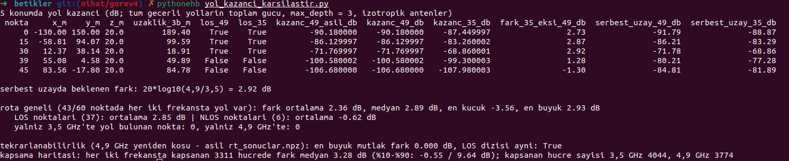

*Şekil 1. `yol_kazanci_karsilastir.py` terminal çıktısı: Münih sahnesinde 5 konumluk yol kazancı tablosu, rota geneli istatistikler ve tekrarlanabilirlik denetimi.*

### Tablo A.1-b — ITU EEF kampüsü, 5 konumda yol kazancı

Kartın 1. adımı "3,5 GHz'te kampüs" başlığını taşımaktadır. Ancak işaret edilen `rt_sehir.py` Münih sahnesini yüklemektedir. Kampüs sahnesi (`ogretici/itu_sahne/`, gNB EEF çatısında, 30 m) için yazılmış olan `prs_itu.py` eski PRS betiğine bağlı olduğundan, periyotlu K ayarlarını ve 3,5 GHz'i desteklememektedir. Bu nedenle aynı karşılaştırma ayrı bir betikle (`itu_35ghz.py`) yapılmıştır.

Bu betikte 200 aday İHA konumu kullanılmıştır: yükseklik 1,5–300 m, 3B uzaklık 30–300 m, bina dışında. Bunlardan 3 LOS (farklı uzaklıklar) ve 2 NLOS konum seçilmiştir.

```bash
~/venvs/ehb415/bin/python itu_35ghz.py
```

| Aday | Konum (x, y, z) [m] | 3B uzaklık [m] | LOS | 4,9 GHz [dB] | 3,5 GHz [dB] | Fark [dB] | Serbest uzay 4,9 / 3,5 GHz [dB] |
|---|---|---|---|---|---|---|---|
| 4 | (63,8; −41,9; 58,5) | 81,5 | var | −84,47 | −81,55 | **+2,92** | −84,47 / −81,55 |
| 11 | (44,8; −132,3; 55,1) | 141,9 | var | −89,29 | −86,37 | **+2,92** | −89,29 / −86,36 |
| 0 | (168,7; 63,5; 213,4) | 257,1 | var | −94,18 | −91,28 | **+2,90** | −94,45 / −91,53 |
| 27 | (−143,0; −124,7; 20,6) | 190,0 | yok | −122,62 | −116,03 | **+6,59** | −91,82 / −88,90 |
| 28 | (−123,6; −53,9; 9,6) | 136,4 | yok | −116,64 | −108,04 | **+8,59** | −88,94 / −86,02 |

İki frekansta da yol bulunan 198 adayın tamamında fark ortalama +3,33 dB, medyan +2,91 dB'dir. LOS (179 aday) ortalaması +2,91 dB, NLOS (19 aday) ortalaması +7,36 dB'dir. LOS sınıflandırması iki frekansta aynı çıkmıştır.

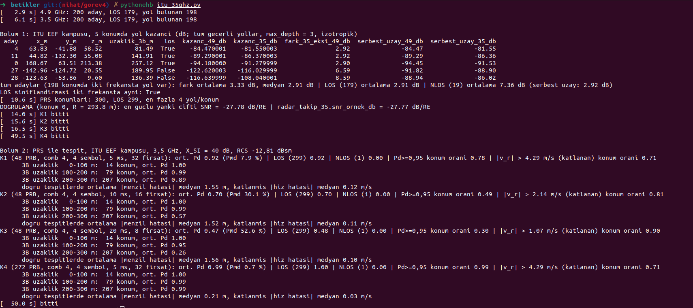

*Şekil 2. `itu_35ghz.py` terminal çıktısı: Bölüm 1, ITU EEF kampüsünde 5 konumluk yol kazancı tablosu; Bölüm 2, PRS ile tespit sonuçları (K1–K4, §B.2).*

### Yorum

İzotropik antenlerle serbest uzay yol kazancı (λ/4πd)² ile orantılıdır. Bu nedenle frekans 4,9'dan 3,5 GHz'e indirildiğinde beklenen artış 20·log10(4,9/3,5) = **2,92 dB**'dir.

LOS konumlarında Sionna RT sonucu bu değerle 0,2 dB içinde uyuşmaktadır. Münih'teki 0 numaralı noktada fark 2,73 dB'dir; bu noktada yer yansıması toplam güce katkı vermekte ve yansıyan yolla doğrudan yolun girişimi frekansa bağlı olarak değişmektedir.

NLOS konumlarında fark sabit değildir. ITU malzeme modelinde (beton, kuru zemin) yansıma, kırınım ve duvardan geçiş kayıpları frekansa bağlıdır. Kampüste duvardan geçen ya da kırınan yollar 3,5 GHz'te belirgin biçimde daha az zayıflamıştır (+6,6 … +8,6 dB). Münih'te ise bir noktada fark eksiye düşmüştür (−1,3 dB).

Sonuç olarak 3,5 GHz'e geçiş, LOS hedefleri için radar bağlantı bütçesine ek bir pay sağlamaktadır. Radar denkleminde bu pay λ² terimi üzerinden de görünmektedir (bkz. §A.2).

---

## A.2 Adım 2: Radar parametreleri ve Pd (Teslim 2)

### Yapılan değişiklikler

`radar_takip.py`, `betikler/radar_takip_35.py` olarak kopyalanmıştır. Değerler kartın istediği gibi dosyadan alınmıştır.

| Parametre | Eski (`radar_takip.py`) | Yeni (`radar_takip_35.py`) | Kaynak |
|---|---|---|---|
| Taşıyıcı frekans f_c | 4,9 GHz (npz) | **3,5 GHz** (`cikti/rt_3p5GHz/rt_sonuclar.npz`) | ortak_degerler.xlsx "Ortak değerler" B2, "Sionna" B2 |
| Dalga boyu λ | 6,12 cm | **8,57 cm** | türetme (c / f_c) |
| Alt taşıyıcı sayısı N | 1024 | **273 × 12 = 3276** | "Sionna" B4; TS 38.101-1 Tablo 5.3.2-1 |
| SCS | 30 kHz | 30 kHz (değişmedi) | "Sionna" B3 |
| Dolu bant W = N·SCS | 30,72 MHz | **98,28 MHz** | türetme |
| Menzil kutusu c/(2W) | 4,88 m | **1,53 m** | türetme |
| Hedef RCS | −20 dBsm (varsayım) | **−12,81 dBsm** (sabit) | TR 38.901 Tablo 7.9.2.1-1, "Ortak değerler" B22 |
| Verici gücü, NF | 37 dBm, 5 dB | aynı | TR 38.765 Tablo A-1 |
| Anten kazancı (Tx = Rx) | 26 dBi | aynı | VARSAYIM (bkz. §G) |
| X_SI | 40 dB (ayrıca 30 dB) | aynı | TR 38.765 Ek A, X şirkete bırakılmış |
| P_FA, ilişkilendirme kapısı | 10⁻³; 3 menzil kutusu | aynı (kapı artık 3 × 1,53 = 4,6 m) | önceki model |

**RCS notu (kartın istediği cümle):** RCS sabit −12,81 dBsm alındı (TR 38.901 Tablo 7.9.2.1-1, küçük drone ortalaması); standarttaki 3,74 dB sapma modellenmedi, bu yüzden sonuçlar iyimser olabilir.

```bash
~/venvs/ehb415/bin/python radar_takip_35.py      # kaynak_basari(): ../cikti/radar_35/kaynak_basari.csv (tr_metrik_olc_35.py bölüm 2 bunu okur)
~/venvs/ehb415/bin/python tr_metrik_olc_35.py    # kartın istediği Pd tablosu + ayrıştırma + SNR bütçesi
```

### Tablo A.2-a — 300 m'de Pd, eski / yeni (kartın istediği tablo; 160 deneme)

| Ayar | X_SI | α = %20 | α = %40 | α = %50 | α = %100 |
|---|---|---|---|---|---|
| Eski: 4,9 GHz, N = 1024, RCS −20 dBsm (kartlar 2) | 40 dB | 0,18 | 0,56 | 0,73 | 0,96 |
| **Yeni: 3,5 GHz, N = 3276, RCS −12,81 dBsm** | 40 dB | **1,00** | **1,00** | **1,00** | **1,00** |
| Eski (kartlar 2) | 30 dB | 1,00 | 1,00 | 1,00 | 1,00 |
| **Yeni** | 30 dB | **1,00** | **1,00** | **1,00** | **1,00** |

Görülen çıktı (`cikti/tr_metrik_olc_35_cikti.txt`, bölüm 3):

```
3) 300 m'de Pd, X_SI_DB'ye gore (160 deneme)
   alpha:          20%    40%    50%   100%
   X_SI=  40 dB:  1.00   1.00   1.00   1.00
   X_SI=  30 dB:  1.00   1.00   1.00   1.00
```

Kart bu adım için bir kontrol değeri vermemektedir ("bizde henüz koşulmadı; senin sonucun ilk sonuç olacak"). Yeni ayarda α = %20 … %100 aralığında tablo doymuştur. Bu yüzden farkın kaynağı daha küçük α değerlerinde de incelenmiştir.

### Tablo A.2-b — Ayrıştırma: farkın RCS'ten mi, frekanstan mı geldiği (300 m, X_SI = 40 dB)

Kart, "RCS'i tek başına değiştirdiğin bir koşu" istemektedir. Bu koşuya ek olarak frekans ve bant da tek tek değiştirilmiştir.

Her satır tohum 11 ile, aynı rastgele sayılarla (ortak rastgele sayılar yöntemi) koşulmuştur; böylece satırlar arasındaki fark Monte Carlo gürültüsünden değil, parametreden kaynaklanmaktadır. A satırı eski ayarın bu yöntemle yeniden ölçümüdür. Kartlar 2'deki değerlerle (0,18 / 0,56 / 0,73 / 0,96) farkı 0,07'yi aşmamaktadır; bu fark Monte Carlo gürültüsü sınırları içindedir.

| Ayar | f_c | N | RCS | α = 2,9 % | 5,7 % | 10 % | 20 % | 40 % | 50 % | 100 % |
|---|---|---|---|---|---|---|---|---|---|---|
| A eski | 4,9 | 1024 | −20 | 0,00 | 0,00 | 0,00 | 0,11 | 0,51 | 0,69 | 0,98 |
| **B yalnız RCS** | 4,9 | 1024 | −12,81 | 0,12 | 0,59 | 0,83 | **0,99** | **1,00** | **1,00** | **1,00** |
| C yalnız frekans | 3,5 | 1024 | −20 | 0,03 | 0,01 | 0,10 | 0,57 | 0,97 | 0,96 | 1,00 |
| D yalnız bant | 4,9 | 3276 | −20 | 0,01 | 0,00 | 0,01 | 0,12 | 0,51 | 0,63 | 0,99 |
| F frekans + RCS | 3,5 | 1024 | −12,81 | 0,61 | 0,97 | 1,00 | 1,00 | 1,00 | 1,00 | 1,00 |
| **E yeni (hepsi)** | 3,5 | 3276 | −12,81 | **0,60** | **0,97** | **0,99** | 1,00 | 1,00 | 1,00 | 1,00 |

X_SI = 30 dB'de bütün ayarlar α ≥ %10 için Pd ≥ 0,99 vermektedir; ayrıntı `cikti/radar_35/ayristirma_pd_300m.csv` dosyasındadır.

### Tablo A.2-c — SNR bütçesi (hesap; 300 m, X_SI = 40 dB, hedef kutu merkezinde)

| Ayar | Örnek başına SNR | M = 28: tepe SNR / eşik / pay | M = 140: tepe SNR / eşik / pay |
|---|---|---|---|
| A eski | −33,20 dB | 11,4 / 11,7 / **−0,3 dB** | 18,4 / 12,1 / +6,2 dB |
| B yalnız RCS | −26,01 dB | 18,6 / 11,7 / +6,9 dB | 25,6 / 12,1 / +13,4 dB |
| C yalnız frekans | −30,27 dB | 14,3 / 11,7 / +2,6 dB | 21,3 / 12,1 / +9,1 dB |
| D yalnız bant | −38,25 dB | 11,4 / 12,0 / −0,6 dB | 18,4 / 12,4 / +5,9 dB |
| **E yeni** | −28,13 dB | 21,5 / 12,0 / **+9,5 dB** | 28,5 / 12,4 / +16,0 dB |

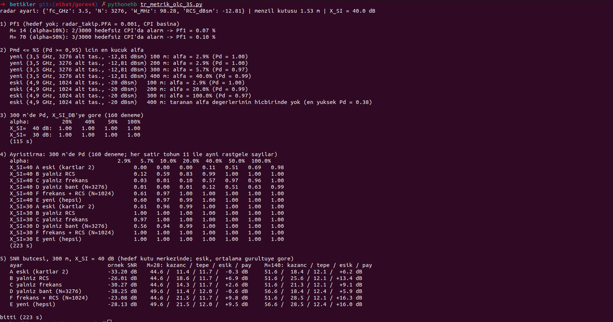

*Şekil 3. `tr_metrik_olc_35.py` terminal çıktısı: (1) yanlış alarm, (2) Pmd ≤ %5 için en küçük α, (3) 300 m'de Pd tablosu, (4) ayrıştırma koşuları, (5) SNR bütçesi.*

`radar_takip_35.py` koşusunun terminal görüntüsü (`ekran_goruntuleri/radartakip.png`) Tablo A.2-d ve A.2-e'deki Pd ve p90 değerlerini içerdiğinden, aynı sonuçların grafiği (`cikti/radar_35/06_kaynak_basari.png`) ise Şekil 3'teki tabloları tekrarladığından rapora eklenmemiştir.

### Ayrıştırmanın yorumu

Radar denkleminden alınan güç ve örnek başına SNR şöyledir:

  P_r = P_t G² λ² σ / ((4π)³ R⁴),  SNR_örnek = P_r / (k T₀ · N·SCS · F · X_SI)

Menzil–Doppler haritasındaki tepe SNR, uyumlu işlem kazancı N·M ile çarpılarak elde edilir:

  SNR_tepe = SNR_örnek · N · M = P_t G² λ² σ M / ((4π)³ R⁴ k T₀ SCS F X_SI)

Bu ifade alt taşıyıcı sayısı N'den bağımsızdır. Toplam verici gücü sabitken bant genişletildiğinde örnek başına SNR 10·log10(3276/1024) = 5,05 dB düşmekte, işlem kazancı aynı miktarda artmaktadır.

Bu nedenle:

1. **RCS** (−20 → −12,81 dBsm): +7,19 dB. Farkın büyük bölümü buradan gelmektedir. Tek başına RCS değişikliği (B satırı), kartın istediği α = %20–100 aralığında Pd'yi 0,99–1,00'e taşımaktadır.
2. **Frekans** (4,9 → 3,5 GHz): +2,92 dB (radar denklemindeki λ² terimi). Bu değer §A.1'de LOS için bulunan yol kazancı farkıyla aynıdır. Tek başına frekans (C satırı) α = %40'ta Pd'yi 0,51'den 0,97'ye taşımaktadır.
3. **Bant** (N = 1024 → 3276): tepe SNR'de net etkisi yoktur. Ancak 450 m içindeki menzil hücresi sayısı 93'ten 295'e çıktığından CFAR eşiği yaklaşık 0,3 dB yükselmektedir. D satırı A satırıyla aynıdır (fark Monte Carlo gürültüsü içinde, en çok 0,06).
4. RCS ve frekans birlikte +10,1 dB getirmektedir. Bu katkı, α'nın on kat azaltılmasına karşılık gelmektedir: E satırında α = %5,7'de Pd = 0,97, A satırında α = %50–100 aralığında Pd = 0,69–0,98'dir.

### Tablo A.2-d — Pmd ≤ %5 (Pd ≥ 0,95) için gereken en küçük α (`kaynak_basari`, X_SI = 40 dB)

| Menzil | Eski (4,9 GHz, 30,72 MHz, −20 dBsm) | Yeni (3,5 GHz, 98,28 MHz, −12,81 dBsm) |
|---|---|---|
| 100 m | %2,9 | %2,9 |
| 200 m | %20 | %2,9 |
| 300 m | %100 | %5,7 |
| 400 m | taranan hiçbir α'da yok (en yüksek Pd 0,38) | %40 |

Yanlış alarm (Pf1, hedefsiz 3000 CPI) yeni ayarda α = %10 için %0,07, α = %50 için %0,10 bulunmuştur. TR 38.765'teki ≤ %5 hedefinin çok altındadır; eski ayarda bu değerler %0,07 ve %0,17 idi.

### Tablo A.2-e — Doğruluk: %90 yüzdelik hatalar (TR 38.765 Tablo 4.2-1: konum 10 m, hız 5 m/s)

| Menzil | α | Eski: menzil / hız p90 | Yeni: menzil / hız p90 |
|---|---|---|---|
| 100 m | %40 | 1,14 m / 3,45 m/s | 0,35 m / 4,76 m/s |
| 100 m | %100 | 1,14 m / 1,33 m/s | 0,35 m / 1,91 m/s |
| 300 m | %40 | 1,47 m / 4,71 m/s (Pd 0,49) | 0,39 m / **5,31 m/s** |
| 300 m | %50 | 1,49 m / 3,96 m/s (Pd 0,71) | 0,39 m / 4,06 m/s |
| 400 m | %50 | – (Pd 0,04) | 0,42 m / **5,01 m/s** |

Üç ölçütü birlikte sağlayan en küçük α değerleri şöyledir (Pd ≥ 0,95, menzil p90 ≤ 10 m, hız p90 ≤ 5 m/s):

| Menzil | Eski | Yeni |
|---|---|---|
| 100 m | %40 | %40 |
| 200 m | %40 | %40 |
| 300 m | %100 | %50 |
| 400 m | yok | %100 |

Menzil hatası, bant genişlemesiyle yaklaşık 3 kat küçülmüştür. Hız hatası ise aynı α'da yaklaşık 1,4 kat (λ oranı, 4,9/3,5) büyümüştür. Doppler kutusu λ/(2·M·T_s) olduğundan, frekansın düşmesi aynı gözlem süresinde hız çözünürlüğünü kötüleştirmektedir. Bu nedenle kısa menzilde bağlayıcı ölçüt hız doğruluğu olarak kalmıştır.

---

## A.3 Adım 3: PRS periyodu ve hız (Teslim 3)

```bash
~/venvs/ehb415/bin/python hiz_tablosu.py
```

### Tablo A.3 — K1–K3 (λ = 8,57 cm, gözlem 160 ms)

| Konfig | Periyot (slot / ms) | 160 ms'deki PRS fırsatı | En büyük hız λ/(4·T_PRS) | Hız çözünürlüğü λ/(2·0,16 s) |
|---|---|---|---|---|
| K1 | 10 / 5 ms | 32 | **4,29 m/s** | **0,27 m/s** |
| K2 | 20 / 10 ms | 16 | **2,14 m/s** | **0,27 m/s** |
| K3 | 40 / 20 ms | 8 | **1,07 m/s** | **0,27 m/s** |

Kartın kontrol değerleriyle (K1: 4,29 ve 0,27; K2: 2,14 ve 0,27; K3: 1,07 ve 0,27) **fark yoktur**. Çözünürlük üç ayarda aynıdır, çünkü gözlem süresi sabittir. Periyodun uzaması yalnızca belirsizliksiz hız penceresini daraltmaktadır.

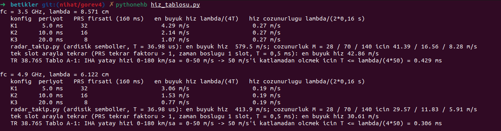

*Şekil 4. `hiz_tablosu.py` terminal çıktısı: K1–K3 için en büyük hız ve hız çözünürlüğü (3,5 GHz ve karşılaştırma için 4,9 GHz).*

Karşılaştırma için bazı ek değerler hesaplanmıştır:
- 4,9 GHz'te aynı ayarlar en büyük hız olarak 3,06 / 1,53 / 0,77 m/s, çözünürlük olarak 0,19 m/s verirdi.
- TR 38.765 Tablo A-1'de İHA yatay hızı 0–180 km/sa (0–50 m/s) olarak verilmektedir. 50 m/s'in katlanmadan ölçülebilmesi için T ≤ λ/(4·50) = 0,43 ms gerekmektedir; bu süre bir slottan (0,5 ms) kısadır.

### Soru 1 – `radar_takip.py` PRS gönderimlerini periyotla mı, ardışık sembollerle mi modelliyor?

**Ardışık sembollerle.** `radar_takip.py` PRS'i hiç modellememektedir:
- Bir CPI, art arda gelen M OFDM sembolünden oluşmaktadır.
- Her sembolde 1024 alt taşıyıcının tamamı rastgele fazlı bilinen sembollerle doludur. Comb ve periyot yoktur.
- Sensing payı α = M/140, 10 ms'lik çerçevenin baştaki M sembolünün kullanılması olarak tanımlanmaktadır.

### Soru 2 – Kodda hangi satır?

Satır numaraları asıl `ogretici/sionna_sehir/radar_takip.py` dosyasına göredir:

| Satır | Kod | Anlamı |
|---|---|---|
| 26 | `TS = (1 / SCS) * (1 + 7 / 64)` | Yavaş zaman örnek aralığı = bir sembol süresi (36,98 µs) |
| 32 | `FRAME_SYM = 140` | α = M / 140 (çerçevedeki sembol sayısı) |
| 45 | `n = np.arange(N)[:, None]; m = np.arange(M)[None, :]` | Sembol indisi m = 0, 1, …, M−1 (ardışık) |
| 46 | `X = np.exp(1j * 2 * np.pi * rng.random((N, M)))` | Bütün N × M kaynak elemanı dolu (comb yok) |
| 48 | `... * np.exp(1j * 2 * np.pi * m * TS * 2 * v / LAM)` | Doppler fazı m·TS ile, yani her sembolde ilerlemektedir |
| 53 | `vax = (np.arange(M) - M // 2) / (M * TS) * LAM / 2` | Hız ekseni: en büyük hız λ/(4·TS) ≈ 580 m/s, çözünürlük λ/(2·M·TS) |

Eski `prs_takip.py` gerçek NR PRS dizisini ve comb yerleşimini kullanmaktadır. Ancak bu betikte tekrarlar art arda slotlara konmaktadır: `GAP = 1` (satır 29), `slot = t * GAP` (satır 59), `VAMB = LAM / (4 * GAP * SLOT)` (satır 31). Dolayısıyla burada da periyot modellenmemiştir; belirsizliksiz hız 0,5 ms'lik slot aralığına göre ±30,6 m/s'dir.

### Soru 3 – PRS periyodunu kodda uygulamak ne gerektirir?

Kart bu değişikliği zorunlu tutmamaktadır. Kart sonuçlarının `radar_takip.py` ile karşılaştırılabilir kalması için periyot `radar_takip_35.py` içinde uygulanmamıştır. CLAUDE.md'nin "birkaç farklı PRS konfigürasyonu denenmeli" maddesi gereği ise ayrı bir betikte (`prs_takip_n78.py`, §B.1) uygulanmıştır. Uygulama sırasında aşağıdaki gereksinimler ortaya çıkmıştır:

1. **Zaman ekseni.** `m·TS` yerine her PRS RE'si için gerçek zaman kullanılmalıdır: t = (slot_ofset + o·T_PRS_slot)·14·T_sym + (sembol_ofset + j)·T_sym. Doppler dönüşümü, PRS fırsatları boyunca yapılmalıdır (K1'de 32 fırsat).
2. **Seyrek yerleşim.** Yalnızca PRS'in doldurduğu RE'ler kullanılmalıdır (TS 38.211 §7.4.1.7.3: comb K, L sembol, k' kaydırması). L sembol birleştirildiğinde bütün alt taşıyıcılar dolmaktadır. Aynı alt taşıyıcıdaki farklı semboller farklı zamanlara düştüğünden, bu sembollerin ortalaması alınmamalı; her comb grubu kendi zamanlarıyla dönüştürülmelidir.
3. **Hız katlanması.** Belirsizliksiz pencere ±λ/(4·T_PRS) değerine (K1: ±4,29 m/s) daralmaktadır. Test edilen −30 … 30 m/s hızların %86'sı bu pencerenin dışında kalmaktadır. Bu nedenle hız hatası katlanmış (modulo 2·v_max) olarak değerlendirilmeli ya da katlanma çözülmelidir. Çözüm seçenekleri şunlardır: PRS tekrar faktörü > 1 ve 1 slot zaman boşluğu ile ±42,9 m/s; farklı periyotlu kaynakların birlikte kullanılması (Çin kalan teoremi türü).
4. **Menzil göçü.** 160 ms boyunca 30 m/s'lik hedef 4,8 m yer değiştirmektedir; bu, 100 MHz'teki 1,53 m'lik menzil kutusunun yaklaşık 3 katıdır. Göç modele eklenmiş, ancak telafi edilmemiştir (keystone dönüşümü gerekir).
5. **Bellek ve hesap.** Tam ızgara 3276 alt taşıyıcı × 4480 sembol (160 ms) olurdu. Bunun yerine yalnızca PRS RE'leri (K1: 18 432, K4: 104 448) tutulmuştur.
6. **α tanımı.** α = M/140 tanımı geçerliliğini yitirmektedir. α_PRS = PRS RE / toplam RE olarak yeniden tanımlanmalıdır; K1'de bu değer %0,126'dır.

---

## A.4 Menzil çözünürlüğü: 30 MHz → 100 MHz (CLAUDE.md, Radar Configuration)

```bash
~/venvs/ehb415/bin/python menzil_cozunurlugu.py
```

**Yöntem.** Çözünürlük önce ΔR = c/(2B) ile hesaplanmıştır. Ardından iki hedefli bir simülasyon yapılmıştır:
- Aynı hızda ve eşit güçte iki İHA, aralarında Δr metre bulunacak biçimde yerleştirilmiştir. Sinyal modeli `radar_takip` ile aynıdır; M = 14 sembol, hedef başına toplam SNR 30 dB, hedefler arası faz rastgeledir.
- Menzil profili 16 kat sıfır dolgulu IFFT ile çıkarılmıştır.
- "Ayrıldı" ölçütü üç koşuldan oluşur: profilde iki yerel tepe bulunmalı, iki tepe arasındaki çukur küçük tepeden en az 3 dB aşağıda olmalı ve tepeler arası uzaklık 0,5·Δr … 1,5·Δr içinde kalmalıdır. Her nokta için 200 deneme yapılmıştır.

### Tablo A.4-a — Hesap

| Ayar | Dolu bant | ΔR = c/(2B) |
|---|---|---|
| `radar_takip.py` (eski) | 1024 × 30 kHz = 30,72 MHz | **4,88 m** |
| `radar_takip_35.py` (yeni, ortak ızgara) | 3276 × 30 kHz = 98,28 MHz | **1,53 m** |
| `prs_takip.py` (eski PRS, 84 PRB) | 30,24 MHz | 4,96 m |
| PRS K1–K3, K6–K11 (48 PRB) | 17,28 MHz | 8,68 m |
| PRS K4 (272 PRB) | 97,92 MHz | 1,53 m |
| PRS K5 (24 PRB) | 8,64 MHz | 17,36 m |
| TR 38.765 FR1 değerlendirme ayarı (100 MHz) | 100 MHz | 1,50 m |

### Tablo A.4-b — Simülasyon: iki hedefin ayırt edilme olasılığı

| Hedefler arası Δr | 48 PRB (17,28 MHz) | Eski radar (30,72 MHz) | Yeni radar (98,28 MHz) |
|---|---|---|---|
| 2 m | 0,00 | 0,00 | 0,68 |
| 3 m | 0,00 | 0,00 | **1,00** |
| 5 m | 0,00 | 0,35 | 1,00 |
| 8 m | 0,33 | **1,00** | 1,00 |
| 12 m | 0,64 | 1,00 | 1,00 |
| 15 m | **1,00** | 1,00 | 1,00 |
| Olasılık ≥ 0,5 için Δr | 10,5 m | 6,0 m | 2,0 m |
| Olasılık ≥ 0,9 için Δr | 13,5 m | 7,5 m | 2,5 m |

**Tek hedef kestirim doğruluğu** (çözünürlükten farklı bir büyüklüktür). Doğru tespitlerde menzil RMSE değeri eski ayarda 0,82–0,99 m, yeni ayarda 0,25–0,31 m bulunmuştur. Kaynak: `cikti/menzil_cozunurlugu/tek_hedef_rmse_eski_yeni.csv`.

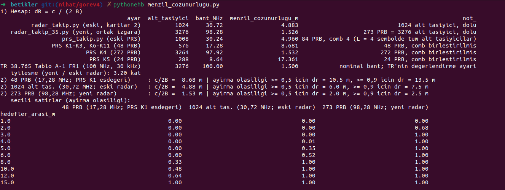

*Şekil 5. `menzil_cozunurlugu.py` terminal çıktısı, 1. ve 2. bölüm: ΔR = c/(2B) hesabı ve iki hedefin ayırt edilme olasılığı. Görüntünün 3. bölümü (tek hedef RMSE tablosu, `ekran_goruntuleri/menzil_cozunurlugu.png`) yukarıdaki cümlede özetlendiğinden kırpılmıştır.*

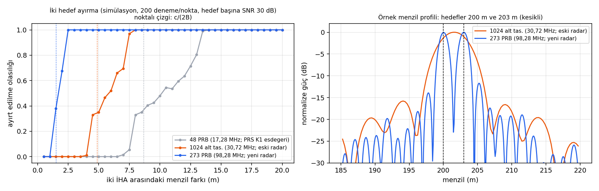

*Şekil 6. İki hedef ayırma simülasyonu: solda ayırt edilme olasılığının hedefler arası uzaklığa göre değişimi (noktalı çizgiler c/(2B)), sağda 200 m ve 203 m'deki iki hedef için örnek menzil profili.*

**Yorum.** 30,72 MHz'ten 98,28 MHz'e geçişte çözünürlük hesapta 3,20 kat iyileşmiştir. Simülasyonda iki hedef, %90 olasılıkla, 7,5 m yerine 2,5 m aralıkla ayrılabilmiştir. Ayırma için gereken uzaklığın c/(2B)'den biraz büyük çıkması iki nedene bağlanmaktadır: dikdörtgen pencerenin ana lob genişliği ve hedefler arası rastgele faz.

PRS ile sensing yapıldığında çözünürlüğü belirleyen büyüklük taşıyıcı bandı değil, **PRS'in kapladığı bant**tır. Ortak PRS ayarlarının çoğu (48 PRB) 8,68 m çözünürlük vermektedir; bu değer eski 30 MHz radarından da kötüdür. 100 MHz'in sağladığı 1,53 m'lik çözünürlük yalnızca K4 (272 PRB) ile elde edilmektedir.

---

# BÖLÜM B — Sionna PRS yapılandırması (CLAUDE.md, "Nihat – Sionna PRS Configuration")

## B.1 PRS sinyalinin n78 ortak ızgarasına taşınması

### Eski ve yeni PRS ayarı

| Öğe | Eski `prs_takip.py` | Yeni `prs_takip_n78.py` |
|---|---|---|
| Taşıyıcı | 4,9 GHz | **3,5 GHz** (n78; `rt_sehir_35.py` npz) |
| SCS | 30 kHz | 30 kHz |
| Hücre bandı | – (gürültü bandı 30,72 MHz) | **100 MHz, 273 PRB** (gürültü bandı 98,28 MHz) |
| PRS bandı | 84 PRB (30,24 MHz) | K ayarına göre: 24 / 48 / 272 PRB |
| Comb, sembol | K = 4, L = 4 | K ∈ {2, 4, 6, 12}, L ∈ {4, 6, 12} (`ortak_prs_konfig.csv`) |
| Zaman yerleşimi | Art arda slotlar (GAP = 1), 4–32 tekrar | **Periyotlu**: T_PRS = 5 / 10 / 20 ms, 160 ms gözlem |
| Dizi ve yerleşim | TS 38.211 §7.4.1.7.2–3 (OCUDU'dan uyarlanmış) | Aynı |

CLAUDE.md'de eski PRS sinyalinin 15 kHz SCS kullandığı yazılmaktadır. Depodaki `prs_takip.py` dosyası ise zaten 30 kHz kullanmaktadır (satır 24). Bu nedenle SCS değişmemiştir; frekans (4,9 → 3,5 GHz) ve bant (30 → 100 MHz) güncellenmiştir. Bu uyumsuzluk §E'de açık nokta olarak kaydedilmiştir.

### Model

Her PRS kaynak elemanı (alt taşıyıcı k, zaman t) için alınan sinyal şöyle modellenmiştir:

  Y(k,t) = a · X(k,t) · e^(−j2π f_k τ₀) · e^(j2π f_D t) · e^(j2π f_k f_D t / f_c) + n(k,t),  f_D = −2 v_r / λ

Son terim menzil göçünü temsil etmektedir: hedef 160 ms boyunca v·t kadar yer değiştirir. Bu göç telafi edilmemiştir.

İşleme iki adımdan oluşmaktadır. Her comb grubu, kendi gerçek sembol zamanlarıyla Doppler'e dönüştürülür (ayrık Fourier dönüşümü, 1/T_gözlem adım). Ardından alt taşıyıcılar boyunca IFFT ile menzil profili elde edilir.

Tespit `radar_takip_35.tespit` ile yapılmıştır: P_FA = 10⁻³, eşik hücre sayısına göre ayarlanır, menzil sınırı 600 m. Tespit, menzil hatası 3 menzil kutusundan küçükse doğru sayılmıştır.

Güç varsayımı şöyledir: PRS RE'si başına enerji (EPRE) veri RE'leriyle aynıdır, yani güç yükseltmesi yapılmamıştır. 37 dBm toplam güç 3276 alt taşıyıcıya eşit dağıtılmaktadır.

Model iki biçimde denetlenmiştir:
- Gürültüsüz durumda menzil ve hız tepeleri doğru kutulara düşmüştür.
- ITU sahnesinde ışın izlemeden elde edilen LOS×LOS yankı çiftinin SNR'i radar denklemiyle 0,01 dB içinde uyuşmuştur: −27,78 ve −27,77 dB/RE.

```bash
~/venvs/ehb415/bin/python prs_takip_n78.py
```

## B.2 PRS konfigürasyonlarının sensing başarımı (K1–K11)

### Tablo B.2-a — Yapılandırmalar ve sonuçlar (3,5 GHz, 160 ms; Monte Carlo 160 deneme, hız −30 … 30 m/s)

| Konfig | PRS bandı | ΔR | Fırsat | PRS RE (160 ms) | α_PRS | İşlem kazancı | v_max | Δv | **Pd (300 m) X_SI = 40** | Pd (300 m) X_SI = 30 | Pd ≥ 0,95 olan en büyük menzil |
|---|---|---|---|---|---|---|---|---|---|---|---|
| K1 | 48 PRB / 17,28 MHz | 8,68 m | 32 | 18 432 | %0,126 | 42,7 dB | 4,29 | 0,27 | **0,57** | 1,00 | 200 m |
| K2 | 48 PRB | 8,68 m | 16 | 9 216 | %0,063 | 39,6 dB | 2,14 | 0,27 | **0,12** | 1,00 | 200 m |
| K3 | 48 PRB | 8,68 m | 8 | 4 608 | %0,031 | 36,6 dB | 1,07 | 0,27 | **0,03** | 0,99 | 100 m |
| K4 | 272 PRB / 97,92 MHz | 1,53 m | 32 | 104 448 | %0,712 | 50,2 dB | 4,29 | 0,27 | **1,00** | 1,00 | 300 m |
| K5 | 24 PRB / 8,64 MHz | 17,36 m | 32 | 9 216 | %0,063 | 39,6 dB | 4,29 | 0,27 | **0,15** | 1,00 | 200 m |
| K6 | 48 PRB, 12 sembol | 8,68 m | 32 | 55 296 | %0,377 | 47,4 dB | 4,29 | 0,27 | **1,00** | 1,00 | 300 m |
| K7 | 48 PRB, comb 2 | 8,68 m | 32 | 36 864 | %0,251 | 45,7 dB | 4,29 | 0,27 | **0,93** | 1,00 | 200 m |
| K8 | 48 PRB, comb 12, 12 sembol | 8,68 m | 32 | 18 432 | %0,126 | 42,7 dB | 4,29 | 0,27 | **0,56** | 1,00 | 200 m |
| K9 | 48 PRB, ofset 0 | 8,68 m | 32 | 18 432 | %0,126 | 42,7 dB | 4,29 | 0,27 | **0,66** | 1,00 | 200 m |
| K10 | 48 PRB, ofset 10 | 8,68 m | 32 | 18 432 | %0,126 | 42,7 dB | 4,29 | 0,27 | **0,66** | 1,00 | 200 m |
| K11 | 48 PRB, comb 6, 6 sembol | 8,68 m | 32 | 18 432 | %0,126 | 42,7 dB | 4,29 | 0,27 | **0,64** | 1,00 | 200 m |

Hız sütunları m/s cinsindendir. α_PRS, PRS RE sayısının 273 PRB × 14 sembol × 320 slotluk toplam RE sayısına oranıdır.

### Tablo B.2-b — Menzile göre Pd (X_SI = 40 dB)

| Konfig | 100 m | 200 m | 300 m | 400 m | 500 m |
|---|---|---|---|---|---|
| K1 | 1,00 | 1,00 | 0,57 | 0,03 | 0,00 |
| K2 | 1,00 | 0,99 | 0,12 | 0,00 | 0,00 |
| K3 | 1,00 | 0,83 | 0,03 | 0,00 | 0,00 |
| K4 | 1,00 | 1,00 | 1,00 | 0,55 | 0,10 |
| K5 | 1,00 | 1,00 | 0,15 | 0,02 | 0,00 |
| K6 | 1,00 | 1,00 | 1,00 | 0,47 | 0,06 |
| K7 | 1,00 | 1,00 | 0,93 | 0,29 | 0,01 |
| K8 | 1,00 | 1,00 | 0,56 | 0,04 | 0,00 |
| K9 | 1,00 | 1,00 | 0,66 | 0,02 | 0,00 |
| K10 | 1,00 | 1,00 | 0,66 | 0,02 | 0,00 |
| K11 | 1,00 | 1,00 | 0,64 | 0,02 | 0,00 |

**Doğruluk** (300 m, X_SI = 40, doğru tespitler, %90 yüzdelik):
- Menzil hatası: K4 için 0,46 m, 48 PRB'lik ayarlar için 2,0–3,0 m, K5 için 5,3 m. Hepsi TR'deki 10 m hedefinin altındadır.
- Ham hız hatası: bütün ayarlarda yaklaşık 22–26 m/s. Bunun nedeni katlanmadır: test hızlarının %86'sı ±4,29 m/s penceresinin dışındadır.
- Katlanmış hız hatası: 0,11–0,34 m/s.

**Yanlış alarm** (hedefsiz 1000 gözlem): K1 için %0,0, K4 için %0,2.

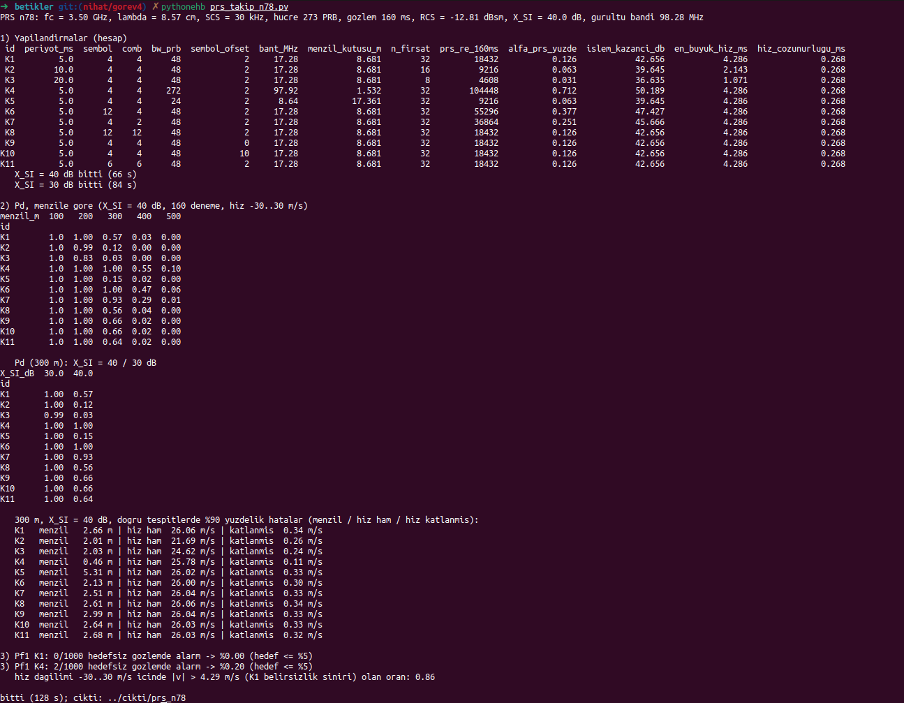

*Şekil 7. `prs_takip_n78.py` terminal çıktısı: K1–K11 yapılandırma hesabı, menzile göre Pd, 300 m'de X_SI = 40 / 30 dB için Pd, %90 yüzdelik hatalar ve yanlış alarm denetimi.*

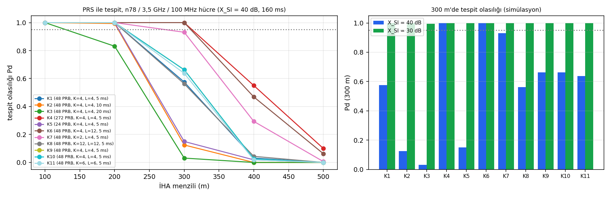

*Şekil 8. PRS ile tespit olasılığı: solda K1–K11 için menzile göre Pd (X_SI = 40 dB), sağda 300 m'de X_SI = 40 ve 30 dB için Pd (noktalı çizgi Pd = 0,95).*

K1 ve K4 için menzil–Doppler haritaları (`cikti/prs_n78/prs_n78_rd_K1_K4.png`) nicel sonuç içermediğinden rapora eklenmemiştir.

### Gözlemler

1. **Pd'yi belirleyen büyüklük, gözlem süresindeki toplam PRS RE sayısıdır**, yani toplanan enerjidir. K1, K8, K9, K10 ve K11 aynı RE sayısına sahiptir (18 432); 300 m'de Pd değerleri 0,56–0,66 aralığında olup Monte Carlo gürültüsü içinde aynıdır. Comb (4 / 12 / 6) ve sembol ofseti sensing başarımını değiştirmemektedir.
2. **Periyot uzadıkça** (K1 → K2 → K3) toplanan RE sayısı yarıya inmektedir. Bunun sonucunda Pd (0,57 → 0,12 → 0,03) ve belirsizliksiz hız penceresi (4,29 → 2,14 → 1,07 m/s) birlikte düşmektedir. Daha seyrek PRS, veri tarafında daha düşük kayıp vermektedir (TBS modeli, 48 PRB, PRB kapatma: K1 %16,7, K2 %8,3, K3 %4,2; Tablo B.3-a). Bu nedenle sensing ile haberleşme arasındaki ödünleşim doğrudan periyot üzerinden kurulmaktadır.
3. **Bant genişliği** (K5 → K1 → K4) hem enerjiyi hem de menzil çözünürlüğünü artırmaktadır. K4, 300 m'de Pd = 1,00 ve 1,53 m çözünürlük ile en iyi sensing ayarıdır. Veri alanı 48 PRB olduğunda K4'ün veri kaybı K1 ile aynıdır (TBS modeli, PRB kapatma: ikisi de 31,75 Mbps; Tablo B.3-a). Veri bütün taşıyıcıya yayıldığında ise K4'ün kaybı %16,6'ya çıkmaktadır (Tablo B.3-b).
4. **Eski PRS ile karşılaştırma.** Eski PRS ayarı (4,9 GHz, 84 PRB, 16 art arda slot) 300 m'de Pd = 0,82 vermişti (`ogretici/sionna_sehir/cikti/prs_basari.csv`). Yeni K1 benzer sayıda RE kullanmaktadır (18 432 / 16 128). Buna karşın Pd 0,57'ye düşmüştür. Bunun nedeni, aynı 37 dBm'in 3,2 kat daha geniş bir taşıyıcıya yayılması ve böylece RE başına SNR'in 5,05 dB düşmesidir; frekans kazancı (+2,92 dB) bu kaybı yalnızca kısmen karşılamaktadır. Bu durum, dar bantlı PRS'in 100 MHz'lik taşıyıcıdan fayda sağlamadığını göstermektedir.
5. **X_SI = 30 dB** alındığında bütün K ayarları 300 m'de Pd ≥ 0,99 vermektedir. Öz-girişim varsayımı, K seçimi kadar belirleyicidir (bkz. görev 2, `nihat_gorev_2/4_xsi_aciklama.md`).
6. **Fiziksel çakışmalar** sensing modelinde dikkate alınmamıştır:
   - K1–K8 ve K11'in PRS sembolleri DMRS sembolü 2 ile çakışmaktadır.
   - K10'un PRS sembolleri DMRS sembolü 11 ile çakışmaktadır.
   - K9 (ofset 0) PDCCH sembolü 0 ile çakışmaktadır.

   Bu RE'lerde PRS'in gönderilmediği varsayılırsa toplanan enerji 1/L … 3/L oranında azalır. Sonuç olarak verilen Pd değerleri bu açıdan iyimserdir (VARSAYIM).

### ITU EEF kampüsü, 3,5 GHz (ışın izlemeli yankı)

`itu_35ghz.py` 2. bölümünde `prs_itu.py` yöntemi kullanılmıştır (TR 38.765 Tablo A-1: TX–hedef ve hedef–RX bağlantılarının birleştirilmesi):
- gNB → İHA yolları Sionna RT ile çözülmüştür (`max_depth = 3`).
- Yankı, gidiş yolu i × dönüş yolu j çiftleri olarak oluşturulmuş; −25 dB altındaki çiftler atılmıştır.
- PRS yerleşimi ve işleme `prs_takip_n78.py`'den alınmıştır.
- 300 İHA konumu kullanılmıştır (yükseklik 25–300 m, 3B uzaklık ≤ 300 m, yatay hız 0–50 m/s); her konumda 10 deneme yapılmıştır.

Bu senaryoda X_SI = 40 dB ve RCS −12,81 dBsm kullanılmıştır. Sonuçlar `cikti/itu_35/prs_itu_35_ozet.txt` dosyasında, terminal çıktısı Şekil 2'dedir; `cikti/itu_35/prs_itu_35_sonuc.png` grafiği aşağıdaki tabloyu tekrarladığından rapora eklenmemiştir.

| Konfig | Ortalama Pd (Pmd) | 0–100 m | 100–200 m | 200–300 m | Pd ≥ 0,95 olan konum oranı | Katlanan hız oranı | Menzil hatası medyanı | Katlanmış hız hatası medyanı |
|---|---|---|---|---|---|---|---|---|
| K1 (5 ms) | **0,92** (%7,9) | 1,00 | 0,99 | 0,89 | 0,78 | 0,71 | 1,55 m | 0,12 m/s |
| K2 (10 ms) | 0,70 (%30,1) | 1,00 | 0,99 | 0,57 | 0,49 | 0,81 | 1,52 m | 0,11 m/s |
| K3 (20 ms) | 0,47 (%52,6) | 1,00 | 0,95 | 0,26 | 0,30 | 0,90 | 1,56 m | 0,10 m/s |
| K4 (272 PRB) | **0,99** (%0,7) | 1,00 | 0,99 | 0,99 | 0,99 | 0,71 | 0,21 m | 0,03 m/s |

Tablodaki değerler Şekil 2'deki koşuya aittir. Bu betiğin önceki bir koşusunda K2 için Pmd %30,0, K3 için ortalama Pd 0,48 (Pmd %52,3) elde edilmiştir (`cikti/itu_35ghz_cikti.txt`). Diğer değerler iki koşuda aynıdır; fark Monte Carlo belirsizliğinin altında kalmaktadır.

Karşılaştırma için eski `prs_itu.py` sonuçları (4,9 GHz, 84 PRB, art arda 8 / 16 / 32 slot) şöyledir: ortalama Pd 0,84 / 0,96 / 0,98; 200–300 m aralığında 0,78 / 0,94 / 0,97 (`ogretici/itu_sahne/prs_itu_ozet.txt`).

300 konumdan 299'unda görüş hattı bulunmaktadır; bu oran TR'deki 25–300 m irtifa aralığından kaynaklanmaktadır. Kampüste ortalama Pd'nin Münih'teki 300 m değerinden yüksek çıkmasının nedeni, konumların 10–300 m'ye yayılmasıdır; ortalamaya daha yakın konumlar da girmektedir. 200–300 m aralığında da sıralama Münih sonucuyla aynıdır: K4 > K1 > K2 > K3. K1 bu aralıkta TR'nin Pmd ≤ %5 hedefini sağlayamamakta (0,89), K4 sağlamaktadır (0,99).

## B.3 PRS'in boş kaynaklarının veriye açılması ve throughput iyileşmesi (Yol 1: TBS hesabı)

### Yöntem

Throughput, TS 38.214 §5.1.3.2'deki taşıma bloğu boyutu (TBS) algoritmasıyla hesaplanmıştır. Algoritmanın adımları şunlardır:
- N′_RE = 12·N_sembol − N_DMRS − N_oh ve N_RE = min(156, N′_RE)·n_PRB.
- N_info = N_RE·R·Q_m·υ.
- N_info > 3824 olduğunda nicemleme yapılır ve TBS = 8·C·⌈(N′_info + 24)/(8·C)⌉ − 24 hesaplanır. N_info ≤ 3824 durumunda Tablo 5.1.3.2-1 kullanılır.

DL hızı, 40 slotluk ufukta bütün DL slotlarının TBS toplamının süreye bölünmesiyle bulunmuştur.

PDSCH yerleşiminde kullanılan değerler ve kaynakları aşağıda verilmiştir:

| Öğe | Değer | Kaynak |
|---|---|---|
| PDSCH sembolleri | 1–13 (13 sembol), sembol 0 PDCCH | CORESET0'ın sembol 0'da bulunması: `ogretici/gorev_karti_prs_gorsel.tex` (ön gözlem). PDSCH'nin sembol 1'den slot sonuna kadar eşlenmesi (eşleme tipi A): VARSAYIM |
| DMRS | Semboller {2, 7, 11}; DMRS sembollerinde veri yok, PRB başına 36 RE | VARSAYIM: TS 38.211 Tablo 7.4.1.1.2-3 (`dmrs-TypeA-Position = pos2`, `dmrs-AdditionalPosition = pos2`); veri içermeyen CDM grubu sayısı 2. OCUDU yapılandırmasında doğrulanmamıştır |
| MCS | 28, `mcs_table: qam64` → Q_m = 6, R = 948/1024; 1 katman | `kurulum/ocudu_testmode_n78_100MHz.yml` (`mcs_table: qam64`; test UE için `cqi: 15`, `ri: 1`); TS 38.214 Tablo 5.2.2.1-2 (CQI 15: 64QAM, 948/1024) ve Tablo 5.1.3.1-1 (MCS 28: aynı Q_m ve R). CQI 15 → MCS 28 eşlemesi ÇIKARIM |
| xOverhead | 0 | VARSAYIM (aşağıdaki duyarlılık notuna bakınız) |
| TDD | 10 slotta 6 DL + 1 karışık + 3 UL; karışık slotta PDSCH yok | `ortak_degerler.xlsx` "Ortak değerler" B12–B15 (OCUDU testinde DL ok = 1200/s) |
| Veri genişliği | Senaryo A: 48 PRB [0..48); Senaryo B: 273 PRB | A: `ortak_degerler.xlsx` "Ortak değerler" B16 (PDSCH aralığı [0..48), ön değer); B: VARSAYIM |
| PRS konumu | PRB 0'dan başlar, slot ofseti 1 (DL slotu) | ortak_prs_konfig.csv |

PRS slotunda dört durum karşılaştırılmıştır:
- **M0:** PRS yok.
- **M1:** PRB kapatma. OCUDU'nun bugünkü davranışıdır (`lib/scheduler/common_scheduling/prs_scheduler.cpp` → `dl_res_grid.fill`; bkz. `ogretici/b5_ocudu.tex`): PRS'in PRB'leri o slotta PDSCH'ye tümüyle kapalıdır.
- **M2:** PRB × sembol düzeyinde rate matching. PRS PRB'lerinde yalnızca PRS sembolleri boşaltılır. Bu tür bir rezervasyon, RRC'nin `RateMatchPattern` yapısıyla (RB ve sembol bitmap'i) UE'ye bildirilebilir.
- **M3:** RE düzeyinde rate matching. Yalnızca PRS'in doldurduğu comb RE'leri veri dışı kalır. Bu durum bir üst sınır olarak ele alınmıştır; PRS comb RE'lerinin UE'ye RE düzeyinde bildirilip bildirilemeyeceği (TS 38.214 §5.1.4) bu çalışmada doğrulanmamıştır.

M2 ve M3'te TBS, kalan veri RE sayısıyla hesaplanmıştır: N_RE = N_RE,başlangıç − N_PRS,veri. Standart TBS formülü rate matching RE'lerini düşmemektedir; bu hesap, "etkin kod oranı sabit tutulur" varsayımına karşılık gelmektedir (VARSAYIM).

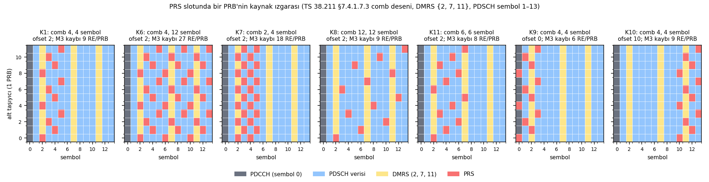

*Şekil 9. PRS slotunda bir PRB'nin kaynak ızgarası (12 alt taşıyıcı × 14 sembol): PDCCH, PDSCH verisi, DMRS ve PRS RE'leri. Başlıklarda M3 durumunda PRB başına kaybedilen veri RE sayısı verilmiştir.*

```bash
~/venvs/ehb415/bin/python prs_veri_tbs.py
```

### Kontrol: PRS'in PDSCH'den düşürdüğü veri RE sayısı (48 PRB) ve kartın beklentisi

| Konfig | Düşen veri RE (M3, model) | PRS slotunda kayıp pay: model (120 RE/PRB'ye göre) | Kartın beklentisi (13 sembole göre) |
|---|---|---|---|
| K1 | 432 | %7,5 | %7,7 |
| K6 | 1296 | %22,5 | %23,1 |
| K7 | 864 | %15,0 | %15,4 |
| K8 | 432 | %7,5 | %7,7 |
| K11 | 384 | %6,7 | %7,7 |

Kartta beklenen pay bu beş ayar için verilmiştir. Kartın verdiği paylar DMRS'i hesaba katmadığından küçük farklar oluşmaktadır. K11'de DMRS iki PRS sembolüyle (2 ve 7) çakıştığı için fark daha büyüktür.

### Tablo B.3-a — Senaryo A: 48 PRB veri alanı (OCUDU test modundaki PDSCH aralığı)

| Konfig | M1 PRB kapatma [Mbps] | M2 PRB×sembol [Mbps] | M3 RE (comb) [Mbps] | M3 − M1 kazancı | Model kaybı M1 / M3 |
|---|---|---|---|---|---|
| K0 | 38,10 | 38,10 | 38,10 | – | 0 / 0 |
| **K1** | 31,75 | 36,26 | **37,69** | **+5,94 Mbps (+%18,7)** | %16,7 / %1,1 |
| K2 | 34,93 | 37,18 | 37,90 | +2,97 (+%8,5) | %8,3 / %0,5 |
| K3 | 36,51 | 37,64 | 38,00 | +1,49 (+%4,1) | %4,2 / %0,3 |
| K4 | 31,75 | 36,26 | 37,69 | +5,94 (+%18,7) | %16,7 / %1,1 |
| K5 | 34,93 | 37,18 | 37,90 | +2,97 (+%8,5) | %8,3 / %0,5 |
| **K6** | 31,75 | 32,40 | **36,67** | **+4,92 (+%15,5)** | %16,7 / %3,8 |
| **K7** | 31,75 | 36,26 | **37,18** | **+5,43 (+%17,1)** | %16,7 / %2,4 |
| **K8** | 31,75 | 32,40 | **37,69** | **+5,94 (+%18,7)** | %16,7 / %1,1 |
| K9 | 31,75 | 36,87 | 37,80 | +6,04 (+%19,0) | %16,7 / %0,8 |
| K10 | 31,75 | 36,26 | 37,69 | +5,94 (+%18,7) | %16,7 / %1,1 |
| **K11** | 31,75 | 35,54 | **37,69** | **+5,94 (+%18,7)** | %16,7 / %1,1 |

### Tablo B.3-b — Senaryo B: 273 PRB veri alanı (tüm taşıyıcı; gerçek 100 MHz sistemini temsil eden durum)

| Konfig | M0 [Mbps] | M1 [Mbps] (kayıp) | M2 [Mbps] (kayıp) | M3 [Mbps] (kayıp) | M3 − M1 kazancı |
|---|---|---|---|---|---|
| K1 | 216,45 | 210,70 (%2,66) | 214,81 (%0,76) | 216,45 (%0,00) | +5,75 Mbps (+%2,7) |
| K2 | 216,45 | 213,57 (%1,33) | 215,63 (%0,38) | 216,45 (%0,00) | +2,88 (+%1,3) |
| K3 | 216,45 | 215,01 (%0,66) | 216,04 (%0,19) | 216,45 (%0,00) | +1,44 (+%0,7) |
| **K4** | 216,45 | **180,51 (%16,6)** | 205,79 (%4,9) | **213,97 (%1,15)** | **+33,46 Mbps (+%18,5)** |
| K5 | 216,45 | 213,97 (%1,15) | 215,62 (%0,39) | 216,45 (%0,00) | +2,48 (+%1,2) |
| K6 | 216,45 | 210,70 (%2,66) | 210,70 (%2,66) | 215,62 (%0,39) | +4,92 (+%2,3) |
| K7 | 216,45 | 210,70 (%2,66) | 214,81 (%0,76) | 215,62 (%0,39) | +4,92 (+%2,3) |
| K8–K11 | 216,45 | 210,70 (%2,66) | 210,70–215,62 | 216,45 (%0,00) | +5,75 (+%2,7) |

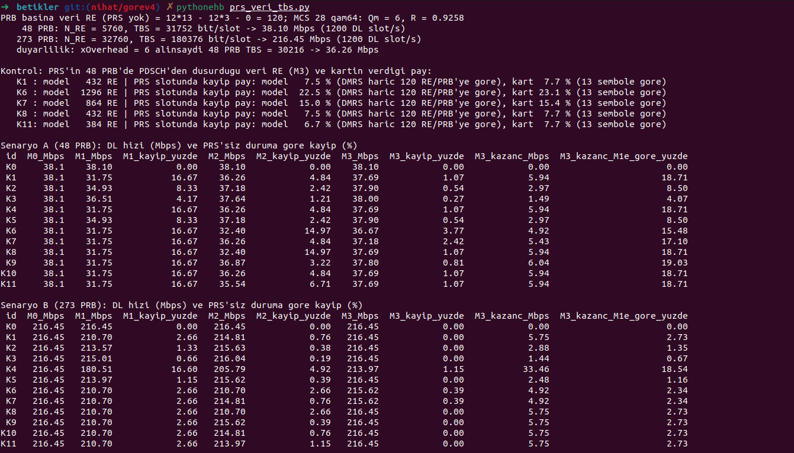

*Şekil 10. `prs_veri_tbs.py` terminal çıktısı: PRS'siz TBS, düşen veri RE kontrolü ve Senaryo A / B için M0–M3 DL hızları.*

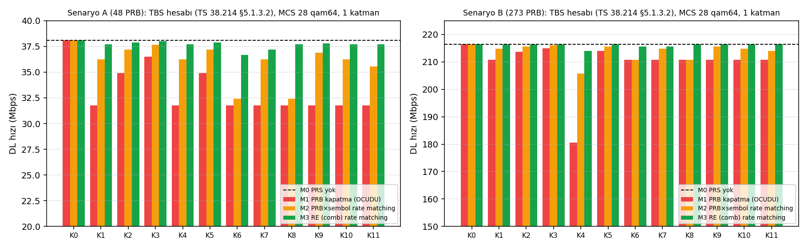

*Şekil 11. TBS hesabıyla DL hızı: solda Senaryo A (48 PRB), sağda Senaryo B (273 PRB); kesikli çizgi PRS'siz durum (M0).*

### Yorum

1. **Senaryo A sonucu.** K1 için RE düzeyinde veri açma DL hızını 31,75'ten 37,69 Mbps'e çıkarmaktadır (+5,94 Mbps, +%18,7). PRB kapatmada (M1) her 6 DL slotundan birinde 48 PRB'lik veri alanının tamamı kapandığından kayıp %16,7'dir; RE düzeyinde açmada (M3) kayıp %1,1'e inmektedir. K6, K7, K8 ve K11'de kazanç +4,92 … +5,94 Mbps arasındadır.
2. **Hangi K ayarı veri açmadan en çok kazanmaktadır?** Kazanç, M1'de kaybedilen kaynakla orantılıdır. K1, K4 ve K6–K11 ayarlarında PRS slotunun tamamı veri için kaybedilmektedir; RE düzeyinde açma bu kaybın %77 (K6) ile %95 (K9) arasındaki bölümünü geri kazandırmaktadır. K6 (12 sembol, comb 4) en çok RE harcayan ayardır ve M3'te bile %3,8 kayıp vermektedir. Buna karşın sensing'de en iyi iki ayardan biridir (§B.2).
3. **Standartla bildirilebilir ara çözüm (M2).** PRS sembolleri az olduğunda (K1, K4, K7, K9, K10) M2, M1'e göre kaybı %16,7'den %3–5'e indirmektedir. 12 sembollü ayarlarda (K6, K8) ise slotun neredeyse tamamı kapandığından M2 kazanç sağlamamaktadır.
4. **Gerçek sistem temsili (Senaryo B).** Veri bütün taşıyıcıya yayıldığında (273 PRB), 48 PRB'lik PRS slot başına yalnızca 48/273 oranında kayıp yaratmaktadır; bu yüzden M1 kaybı %2,7'ye iner. Sensing'de en iyi ayar olan K4 (272 PRB) ise M1'de %16,6 kayıp (−35,9 Mbps) vermektedir. RE düzeyinde açma bu kaybı %1,15'e indirmekte ve 33,5 Mbps geri kazandırmaktadır.

   Bu nedenle tam bant PRS (K4), ancak boş kaynaklar veriye açılırsa haberleşme açısından kabul edilebilir hale gelmektedir. Senaryo B'de K1 ve K8–K11 için M3 kaybının %0,00 çıkması bir TBS nicemleme etkisidir. N_info ≈ 182 000 bit civarında TBS 4096 bitlik adımlarla nicemlenmektedir. Bu adım, 48 PRB'deki 432 RE'lik düşüşten (yaklaşık 2400 bit) büyük olduğundan TBS değişmemektedir.
5. **Standart kısıtı.** M3, PRS comb RE'lerinin PDSCH'den RE düzeyinde dışlanabildiği varsayımına dayanan bir üst sınırdır; bu dışlamanın UE'ye standart mekanizmalarla (TS 38.214 §5.1.4) bildirilebilirliği doğrulanmamıştır. RB ve sembol düzeyinde bildirimle (TS 38.214 §5.1.4.1, RRC `RateMatchPattern`) gerçekleştirilebilen durum M2'dir. Ayrıca K ayarlarının çoğunda PRS sembolleri DMRS sembolleriyle (2, 7, 11) çakışmaktadır. Gerçek bir uygulamada DMRS konumunun ya da PRS sembol ofsetinin değiştirilmesi gerekmektedir.

**xOverhead duyarlılığına ilişkin not.** Model, PRS'siz 48 PRB için xOverhead = 0 ile 38,10 Mbps vermektedir. xOverhead = 6 alındığında bu değer 36,26 Mbps'e inmektedir. OCUDU'nun xOverhead ayarı doğrulanmamıştır. Bu nedenle mutlak hızlar yerine oranların (kayıp yüzdesi, M3 − M1 kazancı) yorumlanması daha güvenilirdir.

---

## C. Sonuç şablonu (Taha'nın birleştirmesi için)

`Nihat_Ortak_Degerler_Tablosu.xlsx` dosyasının "Sonuç şablonu" sayfasında yalnızca Nihat'a ait G, H ve I sütunları doldurulmuştur. DL/UL ölçüm sütunları (B–F) bu görevin kapsamı dışında olduğundan boş bırakılmıştır. Ayrıntılı tablolar aynı dosyadaki "Nihat …" adlı sayfalardadır.

| Konfig | G: Pd (300 m, X_SI = 40 dB) | H: Hız çözünürlüğü [m/s] | I: En büyük hız [m/s] |
|---|---|---|---|
| K0 | PRS yok: sensing yok | – | – |
| K1 | 0,57 | 0,268 | 4,286 |
| K2 | 0,12 | 0,268 | 2,143 |
| K3 | 0,03 | 0,268 | 1,071 |
| K4 | 1,00 | 0,268 | 4,286 |
| K5 | 0,15 | 0,268 | 4,286 |
| K6 | 1,00 | 0,268 | 4,286 |
| K7 | 0,93 | 0,268 | 4,286 |
| K8 | 0,56 | 0,268 | 4,286 |
| K9 | 0,66 | 0,268 | 4,286 |
| K10 | 0,66 | 0,268 | 4,286 |
| K11 | 0,64 | 0,268 | 4,286 |

Tablonun altına eklenen cümleler:
- RCS sabit −12,81 dBsm alındı (TR 38.901 Tablo 7.9.2.1-1, küçük drone ortalaması); standarttaki 3,74 dB sapma modellenmedi, bu yüzden sonuçlar iyimser olabilir.
- Frekans: TR 38.765 değerlendirmesi 4 ve 4,9 GHz; projenin ortak ızgarası 3,5 GHz (TR listesinde yok).
- G sütunu simülasyon sonucudur. X_SI = 30 dB'de K1–K11 için Pd ≥ 0,99 bulunmuştur.

---

## D. Kartın kontrol sayılarıyla karşılaştırma

| Kontrol | Kartta | Bu çalışmada | Fark |
|---|---|---|---|
| K1 en büyük hız / çözünürlük | 4,29 / 0,27 m/s | 4,29 / 0,27 m/s | yok |
| K2 | 2,14 / 0,27 | 2,14 / 0,27 | yok |
| K3 | 1,07 / 0,27 | 1,07 / 0,27 | yok |
| Adım 2 Pd | "henüz koşulmadı" | Tablo A.2-a (ilk sonuç) | – |
| PRS slotunda kapanan pay (kartta verilen hesap) | K1 %7,7, K6 %23,1, K7 %15,4, K8 %7,7, K11 %7,7 | %7,5 / %22,5 / %15,0 / %7,5 / %6,7 | DMRS sembolleri hesaba katıldığı için daha küçük |
| 4,9 GHz RT sonucu (asıl npz) | – | 0,000 dB fark | yok |

---

## E. Açık kalan noktalar ("anlaşılmayan yerler")

1. **"Kampüs" ifadesi.** Kartın 1. adımında "3,5 GHz'te kampüs" yazmaktadır. Ancak `rt_sehir.py` Münih sahnesini kullanmaktadır. Kart metni harfiyen uygulanmış (Münih), kampüs için ayrı betik yazılmıştır. Hangisinin kastedildiği netleştirilmelidir.
2. **CLAUDE.md'deki "15 kHz" ifadesi.** Eski PRS betiği (`prs_takip.py`) 30 kHz kullanmaktadır; 15 kHz kullanan bir Sionna PRS betiği depoda bulunamamıştır. Güncelleme frekans ve bant üzerinden yapılmıştır.
3. **Sembol süresi.** `radar_takip.py` için T_s = (1/SCS)·(1 + 7/64) = 36,98 µs kullanılmaktadır. Normal CP ile 30 kHz'te ortalama sembol süresi 0,5 ms / 14 = 35,71 µs'dir; fark %3,6'dır. "Sionna" sayfasının B6 hücresindeki "(ÇIKARIM) kontrol edilecek" notu bu farkı kastetmektedir. Kopyada değer kart gereği korunmuştur. `prs_takip_n78.py` ise 0,5 ms / 14 değerini kullanmaktadır. Fark, hız ekseni ölçeğini %3,6 etkilemektedir.
4. **PDSCH ayarları.** TBS hesabında kullanılan DMRS konumları ({2, 7, 11}) ve xOverhead (0) OCUDU yapılandırmasında doğrulanmamıştır. xOverhead = 6 alınması, PRS'siz 48 PRB hızını 38,10 Mbps'ten 36,26 Mbps'e indirmektedir.
5. **DMRS–PRS çakışması.** K ayarlarının çoğunda PRS sembolleri DMRS sembolleriyle çakışmaktadır. Bunun hem sensing'deki (PRS RE kaybı) hem de veri tarafındaki (M2/M3'ün uygulanabilirliği) sonucu açık kalmıştır.
6. **X_SI değeri.** Pd sonuçları, öz-girişim varsayımına RCS ve frekans kadar duyarlıdır. Proje genelinde X'in tek bir değerde sabitlenmesi gerekmektedir.

## F. Taha'ya iletilecek dosya notları (ortak_degerler.xlsx)

- Kullanıcının `gorev_kartlari_4/ortak_degerler.xlsx` kopyasında K11 satırı bulunmamaktadır; depo sürümünde bulunmaktadır.
- "Sionna" sayfasının B6 hücresinde T_s = 36,98 µs yazılıdır. Normal CP ortalaması 35,71 µs'dir (madde E.3).
- "PRS konfigürasyonları" sayfasındaki model kaybı sütunu M1 (PRB kapatma) durumuna karşılık gelmektedir. RE düzeyinde açma (M3) ve PRB×sembol rate matching (M2) için model değerleri "Nihat throughput (TBS)" sayfasındadır.
- `ortak_degerler.xlsx` dosyasına 4 / 4,9 GHz yanında 3,5 GHz için RCS sapmasının (3,74 dB) frekansa bağlı olup olmadığı notu eklenebilir. TR 38.901 tablosunun 3,5 GHz için ayrı değer verip vermediği doğrulanmamıştır.

## G. Standartta tanımlı olmayan varsayımlar

| Varsayım | Değer | Nerede |
|---|---|---|
| Anten kazancı (Tx = Rx), ışın hep hedefe dönük | 26 dBi | radar_takip_35, prs_takip_n78, itu_35ghz. Not: TR 38.765 konfig. A (8×8 eleman, ITU-R M.2412 eleman kazancı 8 dBi) ile 8 + 10·log10(64) ≈ 26 dBi uyumlu görünmektedir (ÇIKARIM) |
| Artık öz-girişim | X_SI = 40 dB (ve 30 dB) | Tüm radar betikleri. TR 38.765 X'i şirkete bırakmaktadır |
| RCS | Sabit −12,81 dBsm; 3,74 dB sapma yok | Tüm radar betikleri |
| PRS EPRE | Veri EPRE'si ile aynı; güç yükseltme yok | prs_takip_n78 |
| Gözlem süresi | 160 ms (kartın verdiği değer) | prs_takip_n78, itu_35ghz |
| Hedef hızı | −30 … 30 m/s düzgün (Münih); yatay 0–50 m/s (ITU, TR) | |
| İlişkilendirme kapısı | 3 menzil kutusu | Tüm radar betikleri |
| Menzil göçü | Modelde var, telafi yok | prs_takip_n78 |
| DMRS/PDCCH–PRS çakışması | Sensing'de yok sayıldı; veri tarafında DMRS lehine | prs_takip_n78, prs_veri_tbs |
| DMRS | Semboller {2, 7, 11}, sembolde veri yok | prs_veri_tbs (TS 38.211 Tablo 7.4.1.1.2-3, `dmrs-AdditionalPosition = pos2`; OCUDU'da doğrulanmamıştır) |
| xOverhead | 0 | prs_veri_tbs |
| M2/M3'te TBS | Kalan RE ile (etkin kod oranı sabit) | prs_veri_tbs |
| Senaryo B | Tek UE, 273 PRB, 1 katman, MCS 28 qam64 | prs_veri_tbs |
| Karışık slot | PDSCH yok | prs_veri_tbs (OCUDU ok = 1200/s ile uyumlu) |
| Münih 5 konum seçimi | Rota noktaları 0, 15, 30, 39, 45 | yol_kazanci_karsilastir |

## H. Çıktı dosyaları

| Dosya | İçerik |
|---|---|
| `cikti/rt_3p5GHz/`, `cikti/rt_4p9GHz/` | `rt_sonuclar.npz`, `yol_kazanci_rota.csv`, `01_sahne.png`, `02_kapsama_3b.png`, `04_yollar.png`, `04_yollar_tablo.csv` |
| `cikti/yol_kazanci_5_konum.csv`, `cikti/itu_35/yol_kazanci_5_konum_itu.csv` | Teslim 1 tabloları |
| `cikti/radar_35/` | `kaynak_basari.csv`, `06_kaynak_basari.png`, `ayristirma_pd_300m.csv` |
| `cikti/prs_n78/` | `prs_n78_ozet.csv`, `prs_n78_monte_carlo.csv`, `prs_n78_pd_menzil.png`, `prs_n78_rd_K1_K4.png` |
| `cikti/veri_tbs/` | `tbs_sonuclar.csv`, `prs_prb_izgara.png`, `tbs_hiz_karsilastirma.png` |
| `cikti/menzil_cozunurlugu/` | `menzil_cozunurlugu_hesap.csv`, `iki_hedef_ayirma.csv`, `tek_hedef_rmse_eski_yeni.csv`, `menzil_cozunurlugu.png` |
| `cikti/itu_35/` | `prs_itu_35_sonuclar.csv`, `prs_itu_35_ozet.txt`, `prs_itu_35_sonuc.png` |
| `cikti/*_cikti.txt` | Her betiğin tam terminal çıktısı (çalıştırılan komutun gördüğü çıktı) |
| `ekran_goruntuleri/` | Terminal ekran görüntüleri (10 adet ve Şekil 5 için kırpılmış bir kopya) |

Ekran görüntülerinin listesi `EKRAN_GORUNTULERI.md` dosyasındadır. Bu listedeki 8. görüntü (`radar_takip.py` kod satırları) ve 12. görüntü ("Sonuç şablonu" sayfası) alınmamıştır; içerikleri metin olarak §A.3 (Soru 2 tablosu) ve §C'de verilmiştir.
